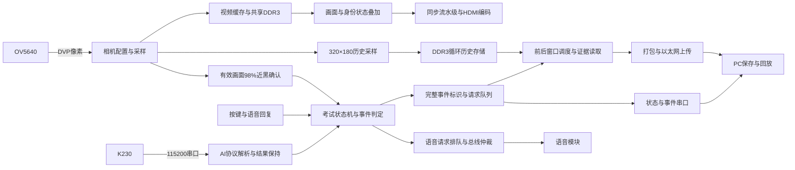

# 系统架构与FPGA设计

FPGA是系统的执行与取证核心。它接收K230给出的视觉线索，同时独立采集OV5640画面，推进考试流程、生成报警、控制显示和语音、保存并上传证据。PC负责管理记录与复核交互。

## 为什么采用两路摄像头

| 通道 | 连接位置 | 当前程序使用的画面 | 主要职责 |
| --- | --- | --- | --- |
| K230自带摄像头 | K230板卡 | 采集与小屏640×480；目标模型输入320×320 | 身份识别、手机/紫书候选、左右头姿 |
| OV5640 | FPGA相机接口 | 1280×720视频链路；历史采样320×180 | HDMI显示、近黑遮挡检测、事件前后图像记录 |

两台相机需要朝向同一考位，但视角可以不同。K230的小屏框属于识别通道；PC证据回放主要来自FPGA的OV5640采集通道。系统按事件时间关联两路信息，没有把两路画面做像素级配准。

## FPGA内部数据流

模块名、源码与自检对应关系见[模块导航](../sim/readme.md)。

## 关键模块

| 设计部分 | 实现方式 | 验证入口 |
| --- | --- | --- |
| 摄像头初始化 | 寄存器配置、应答检查、失败重试 | [camera_init](../sim/modules/camera_init.md) |
| 像素采样 | 按像素时钟、行和帧同步拼接RGB565 | [DVP_Capture](../sim/modules/dvp_capture.md) |
| 考试流程 | 身份核对、考试、交卷等阶段转换；倒计时与事件处理 | [exam_fsm](../sim/modules/exam_fsm.md) |
| AI结果接收 | 串口字节解析、协议校验、结果更新 | [ai_link_rx](../sim/modules/ai_link_rx.md) · [ai_mailbox](../sim/modules/ai_mailbox.md) |
| 视频与DDR | 读写仲裁、突发传输、响应检查与历史缓存 | [ddr3_axi_frame_dma](../sim/modules/ddr3_axi_frame_dma.md) · [history_store_axi](../sim/modules/history_store_axi.md) |
| 证据调度 | 同一事件关联前后采样窗口，处理重叠请求和缺口 | [history_closed_scheduler](../sim/modules/history_closed_scheduler.md) |
| 网口 | 数据封装、管理接口、GMII/RGMII转换 | [eth_udp_tx_gmii](../sim/modules/eth_udp_tx_gmii.md) · [gmii_to_rgmii](../sim/modules/gmii_to_rgmii.md) |
| HDMI | 文字叠加、颜色与同步对齐、编码输出 | [candidate_overlay](../sim/modules/candidate_overlay.md) · [display_output_pipeline](../sim/modules/display_output_pipeline.md) |
| 语音 | 同类待播请求合并，播报中接收后续请求，按场次取消旧请求 | [voice_notice_queue](../sim/modules/voice_notice_queue.md) |
| 遮挡 | 统计有效相机画面的近黑比例，连续确认与恢复释放 | [camera_black_gate](../sim/modules/camera_black_gate.md) |

## 优化依据

在同一器件及最终时钟预算下，优化同步属性、DDR就绪传递、网口MDC计数、高扇出复位布线，并在HDMI编码前统一增加一拍。相较前一语音版本，LUT由41473变为41440，寄存器由44610变为44643，WNS由+0.134ns变为+0.374ns，BRAM和DSP保持不变。

主要收益是时序余量与接口结构改善。详见[当前时序报告](../build/reports/quality_current/timing.rpt)、[物理核查](../build/reports/quality_physical)与[资源原生图](../sim/images/implementation/resources/vivado_utilization_summary.png)。CDC结构分类与外部接口预算保存在[工程核查](../qa/quality)中。

文档原有的[总框图](figures/system_architecture.png)、[考试流程](figures/exam_flow.png)、[证据流程](figures/evidence_flow.png)、[K230流程](figures/k230_flow.png)和[PC流程](figures/pc_flow.png)均可单独查看。
