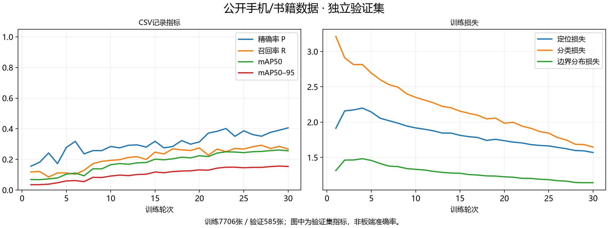
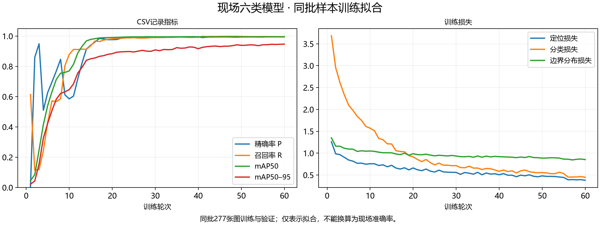
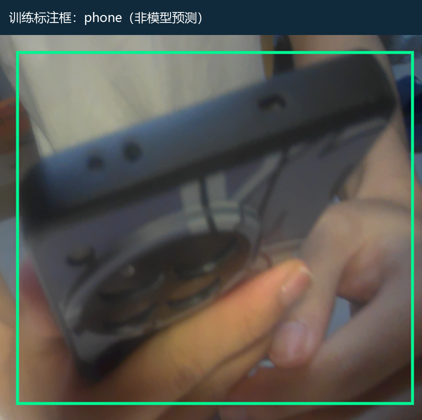
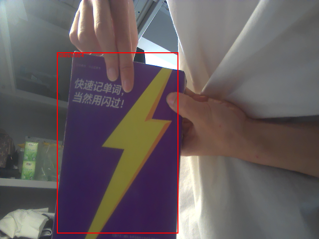

# K230视觉训练与识别展示

K230提供身份、手机、指定紫书和左右头姿线索，FPGA负责事件判定、显示、语音和取证。下面保留真实训练记录与板端输出，图像素材的来源和SHA见[素材索引](showcase/index.json)。

## 使用的数据

| 数据 | 本工程记录 | 用途 |
| --- | --- | --- |
| COCO2017手机/书籍子集 | 8291张；训练7706、验证585；负例分别1000、200，已包含在总数内 | 手机和书籍外观训练，30轮、320输入 |
| 现场六类样本 | 277张，含34张负例；phone、notes、正视、低头书写、左转、右转 | 六类现场模型微调，60轮；训练和验证为同批图 |
| Open Images开发对照 | 116张；phone118框、book103框 | 跨来源外观对照，未把全部对照图称作当前训练输入 |
| 紫书现场采样 | 2026-10-30保存的原始帧、候选框与颜色统计 | 核对书籍候选和紫色封面辅助条件 |

COCO来源：<https://cocodataset.org/#download>；Open Images来源：<https://storage.googleapis.com/openimages/web/index.html>。公开数据按原许可取得；本仓库展示记录与曲线，不重新分发整套原始图片。

## 训练曲线

### 公开数据验证

30轮末记录：P=0.40568、R=0.26752、mAP50=0.25611、mAP50–95=0.15383。指标来自公开子集验证；不等于K230整机现场识别率。

[原始CSV](model_records/public_objects320_v2_20261026t112230194049z/original_training/results.csv) · [训练配置与数据审计](model_records/public_objects320_v2_20261026t112230194049z/run_metadata/input.json)

### 现场样本拟合

60轮末记录：P=0.99518、R=0.99630、mAP50=0.99500、mAP50–95=0.94679。训练与验证使用同批277张图，这些数值表示训练拟合，不作为独立测试或现场准确率。

[原始CSV](model_records/field_six320_fit_v1_20261026t143703142303z/original_training/results.csv) · [样本范围与类别](model_records/field_six320_fit_v1_20261026t143703142303z/run_metadata/input.json)

## 标注框与实际识别框

| 训练标注示例 | K230同帧识别输出 |
| --- | --- |
|  |  |
| 手机真实训练图，按保存的标签坐标绘框；仅裁切和等比放大。 | 2026-10-30实际采样，notes候选分数0.654，紫色比例约0.605；该采样UART关闭，用于识别框核对。 |

左图是标签，右图是模型输出，两者用途不同。模型分数0.654不表示准确率65.4%。右图也不代替2026-11-01的现场报警记录。

## 当前上板程序如何使用模型

1. SD入口自动加载现有人脸、六类目标及手机/书籍辅助模型，采集与小屏画面640×480，目标推理输入320×320。
2. 目标输出经阈值和连续结果处理；紫书使用已有书籍候选加紫色封面筛选。普通试卷、答题纸、衣裤、笔袋不属于资料目标。
3. 人脸特征与本机登记库比较；头姿、目标和身份结果经115200串口交给FPGA。
4. FPGA结合考试阶段处理事件，驱动语音及显示，关联OV5640证据；PC保存并提供复核。

当前SD文件映射及模型SHA见[SD清单](../board/k230/sdcard_manifest.json)。本次展示整理没有重训或更换已验收模型；2026-11-01现场复测由用户反馈通过，见[板级记录](../board/verification/readme.md)。
