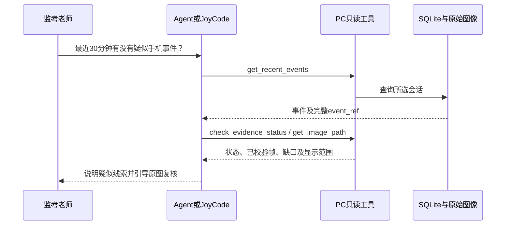

# Agent、JoyCode与网页复核

三种入口共用PC保存的事件与证据。FPGA持续执行考试、显示、告警与取证，大模型根据用户问题按需查询。

## 两种助手如何分工

| 入口 | 主要用途 | 工作方式 |
| --- | --- | --- |
| Agent助手（日常） | 快速问近期报警、查一条证据、辅助看图 | 桌面内对话；文本模型调用本地工具，视觉复核按用户操作发送最多3帧 |
| JoyCode联动（专业智能体） | 使用自定义Skills、Rule、Prompt组织复核步骤 | 对话在JoyCode内部；通过examguard MCP读取同一选定会话 |
| 网页复核 | 从浏览器进入查询界面 | 桌面生成并应用密码后，使用界面显示的当前地址登录 |

JoyCode的工作流配置属于智能体定制；模型权重训练另见[K230训练记录](recognition.md)。

## 四个只读工具

| 工具 | 回答的问题 |
| --- | --- |
| `get_recent_events` | 所选会话、指定分钟范围内有哪些疑似事件？ |
| `check_evidence_status` | 指定完整事件引用的像素与采集结果是否完整？ |
| `get_image_path` | 哪些经过校验的帧可在本机查看？ |
| `get_system_health` | 最后收到什么状态、是否新鲜、温度是否有效？ |



## 桌面与JoyCode交接

在桌面选择当前会话或历史存档，JoyCode联动页会发布明确的数据源；MCP配置使用`--current-session-file`跟随该选择。正常切换场次无需每次手改SQLite文件路径。首次应复制桌面生成的MCP配置到JoyCode，启用examguard后确认四工具可见。

日常助手可交接问题、完整事件引用和所选数据源给专业工作流；专业查询后可回到桌面查看证据。文件路径和工具元数据不等于JoyCode已经读取了图像。

## 可直接使用的提问

```text
请查询当前选定会话最近30分钟的疑似手机事件。说明查询范围，列出最新3条完整event_ref；先核对最新一条的证据状态与图像信息，再说明可以查看什么。
```

```text
请查询系统最后收到的状态，分别说明最后接收时间、是否停更、所选来源是否实时、温度是否有效。不要用历史健康状态证明当前在线。
```

```text
请复核刚才返回的完整event_ref，分别说明像素帧与采集结果的状态、可查看帧数以及结果是否截断。不要把未收到证据直接归因为UDP丢包。
```

## AI看图与网页登录

AI看图从本机已校验图像中抽样最多3帧，界面同时显示发送数量、请求模型和最近响应模型。它辅助描述所见内容，老师仍须查看原始证据；看过3帧不等于检查了全部窗口。

网页服务由桌面启动。应用新密码后使用界面显示的当前地址，新密码登录，旧密码及旧会话失效；地址与访问范围以本机配置为准。桌面关闭或服务停止后，该地址不继续提供查询。配置样例见[Agent创建说明](../board/pc/agent_profile.md)，完整接口与本地测试见源码及[PC结果](../sim/results/quality_pc/result.json)。
