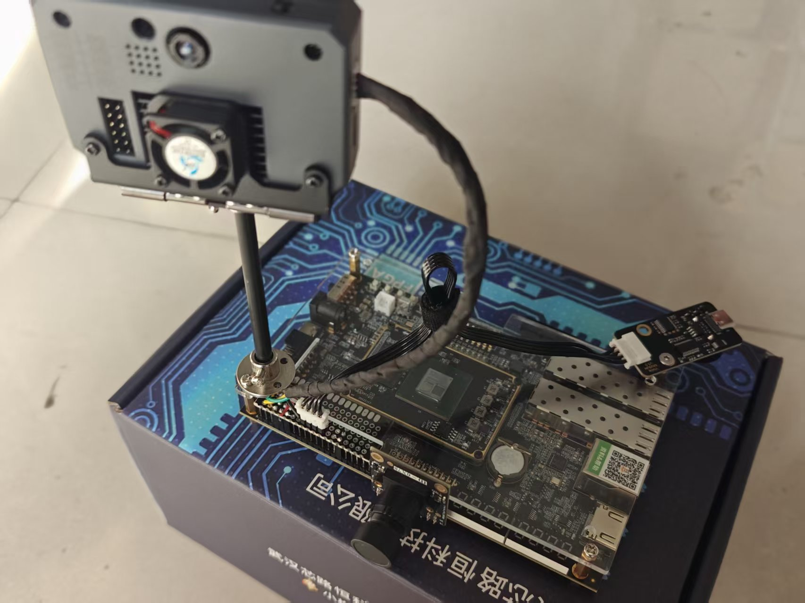
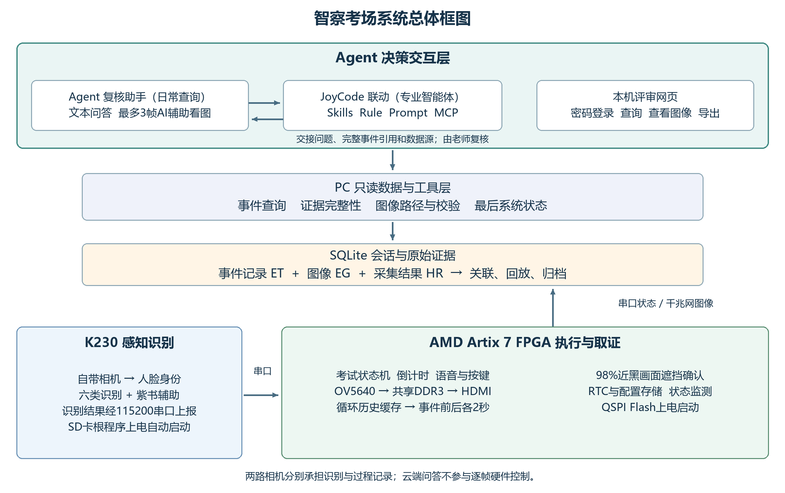

# 智察考场（FPGA＋K230＋语音助手）

以 **AMD Artix-7 FPGA 为执行与取证核心**，结合 K230 视觉识别，完成身份核对、考试计时、异常提示、事件前后图像保存与人工复核。两路摄像头分别承担识别和过程记录；PC上的Agent、JoyCode和登录网页共用同一套证据查询工具。



实物结构照片。上方为K230显示与识别终端，下方为FPGA主板和外接OV5640；运行验证记录见[板级验证](board/verification/readme.md)。

## 从这里开始

| 查看内容 | 入口 |
| --- | --- |
| FPGA架构、双摄像头分工、关键设计 | [系统架构](data/architecture.md) |
| 各模块如何连接、数据走哪条线 | [通信链路](data/communication.md) |
| 摄像头、遮挡与识别算法 | [算法说明](data/algorithms.md) |
| 逐模块仿真、原生日志和波形 | [163个模块导航](sim/readme.md) · [8张Vivado原生波形](sim/waveforms.md) |
| K230数据集、训练曲线、标注与识别框 | [视觉训练与展示](data/recognition.md) |
| Agent、JoyCode、网页登录与复核 | [复核应用](data/review_workflow.md) |
| 工具版本、环境检查、一键复原 | [从零复原](build/reproduction.md) |
| 设计报告、协作记录与技能 | [报告](report/readme.md) · [技能包](skill/readme.md) |

## 系统框图



FPGA负责持续的视频、状态机、语音排队和证据采集；K230输出身份、目标和头姿线索。大模型按需查询PC已保存的数据，老师查看原图后完成复核。

## FPGA实现特色

- **双路视觉各司其职**：K230在640×480画面中识别人脸、手机、指定紫书和头姿；OV5640由FPGA采集，形成1280×720显示链路及320×180历史证据帧。
- **事件有前后文**：DDR3循环保存历史采样，报警关联前后各2秒的目标窗口；事件、像素帧和采集结果使用完整事件引用关联，PC核对帧号、CRC及哈希后回放。
- **考试流程由硬件推进**：身份核对、准备、开考、计时、告警和交卷由状态机管理；语音请求排队，可承接连续报警和不同类别报警。
- **显示与接口同步处理**：视频、DDR、网口和控制分属不同工作时钟；跨时钟传递采用同步链、FIFO和快照机制。HDMI颜色与同步信号统一增加一拍，保持输出对齐。
- **上电可演示**：FPGA程序及语音数据固化于QSPI Flash；K230从SD卡自动启动。PC提供记录、回放与自然语言复核。

## 当前版本结果

器件 **xc7a200tfbg484-2**；工具 **Vivado 2018.3 build 2405991**。保持该版本以匹配已有板卡工程及IP配置，工具路径可配置。

| 项目 | 结果 | 来源 |
| --- | ---: | --- |
| LUT | 41,440 / 30.97% | 当前版本实现报告 |
| 寄存器 | 44,643 / 16.68% | 当前版本实现报告 |
| BRAM / DSP | 70.5 / 3 | 当前版本实现报告 |
| WNS / WHS | +0.374ns / +0.027ns | 布线后时序报告 |
| 建立/保持失败端点 | 0 / 0 | 布线后时序报告 |
| RTL自检 / PC本地测试 | 163 / 122通过 | 保存的逐项结果 |
| Flash | 16MiB完整写入及逐字节读回通过 | 本轮板卡记录 |
| 上电与现场流程 | 冷启观察及用户现场复测通过 | 2026-11-01板级记录 |

[资源原生截图](sim/images/implementation/resources/vivado_utilization_summary.png) · [时序原生截图](sim/images/implementation/timing/vivado_timing_summary.png) · [原始实现报告](build/reports/quality_current/timing.rpt) · [版本与校验](board/current_release.json)。资源和时序来自与固化位流对应的实现报告；现场功能、仿真结果及训练指标各保留自己的来源。

## 目录

```text
examguard-fpga-k230-voice/
├── readme.md           项目介绍与复原入口
├── src/                FPGA RTL、IP配置、K230与PC源码
├── sim/                模块验证脚本、结果、日志与波形
├── build/              构建脚本、工具说明、综合与实现报告
├── bit/                当前bit与完整Flash烧录镜像
├── board/              位流、Flash镜像、SD映射与板级记录
├── data/               算法、通信说明、训练与参考数据
├── skill/              可复用工作流和校验工具
├── report/             设计报告、框图与大模型协作记录
├── tools/              统一复原及文件核查入口
└── qa/                 版本、来源和工程核查记录
```

## 快速复原

Windows x64、Python3.12、Vivado2018.3与Icarus12.0环境下，将仓库放到英文路径。先按[复原说明](build/reproduction.md)配置工具，然后运行：

```powershell
# 文件与工程依赖核查
powershell -NoProfile -ExecutionPolicy Bypass -File tools/reproduce.ps1
# 关键模块仿真
powershell -NoProfile -ExecutionPolicy Bypass -File tools/reproduce.ps1 -Mode quick
# 全量验证、SD准备和FPGA构建
powershell -NoProfile -ExecutionPolicy Bypass -File tools/reproduce.ps1 -Mode full
```

脚本为每次执行建立独立结果目录。板卡连接、K230身份登记和PC模型账户配置见复原说明；脚本不自动烧板。

团队原创贡献采用[MIT许可](license.txt)，第三方代码、厂商IP、框架及模型保留各自条款，见[来源与许可](third_party_notices.md)。

烧录文件：[bit](bit/readme.md)；证据保存：[统一目录配置](board/pc/storage.md)。
