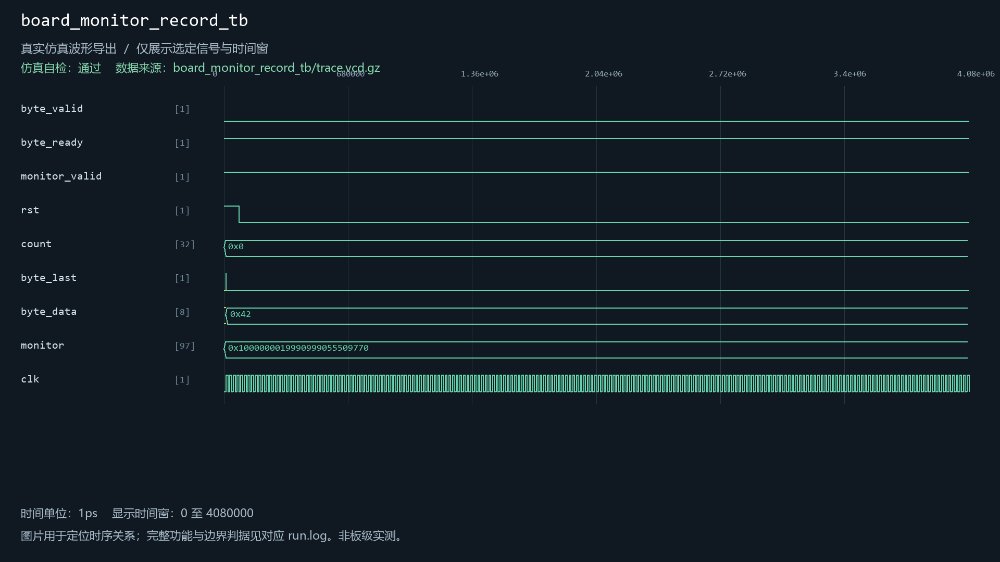
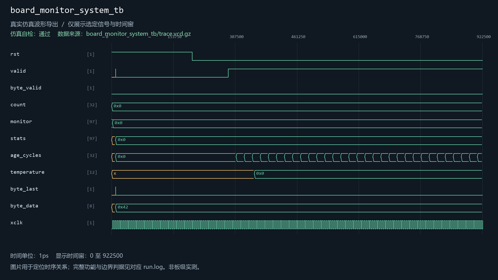

# board_monitor_record

当前工程实例化：是。关联3个自检用例。

| 用例 | 仿真器 | 当前结果 | 运行日志 | 结果记录 |
| --- | --- | --- | --- | --- |
| board_monitor_record_tb | icarus | 通过 | [日志](../../sim/results/quality_current/board_monitor_record_tb/run.log) | [记录](../../sim/results/quality_current/board_monitor_record_tb/result.json) |
| board_monitor_system_tb | xsim | 通过 | [日志](../../sim/results/quality_current/board_monitor_system_tb/run.log) | [记录](../../sim/results/quality_current/board_monitor_system_tb/result.json) |
| transaction_uart_integration_tb | xsim | 通过 | [日志](../../sim/results/quality_current/transaction_uart_integration_tb/run.log) | [记录](../../sim/results/quality_current/transaction_uart_integration_tb/result.json) |

单独重跑本模块关联用例（工程根目录）：

```powershell
python sim/run_module_tests.py --only board_monitor_record_tb board_monitor_system_tb transaction_uart_integration_tb --vivado-bin "$env:EXAMGUARD_VIVADO_BIN" --iverilog-bin "$env:EXAMGUARD_IVERILOG_BIN"
```

先按[复原说明](../../build/reproduction.md)配置工具。每次生成新的结果目录。

## board_monitor_record_tb

用例源码：[board_monitor_record_tb.sv](../../sim/sources/health/board_monitor_record_tb.sv)

历史VCD数据导出图（并非Vivado截图）：



## board_monitor_system_tb

用例源码：[board_monitor_system_tb.sv](../../sim/test_repairs/board_monitor_system_tb/board_monitor_system_tb.sv)

历史VCD数据导出图（并非Vivado截图）：



## transaction_uart_integration_tb

用例源码：[transaction_uart_integration_tb.sv](../../sim/sources/host_link/transaction_uart_integration_tb.sv)

本用例提供上方日志和机器可读结果；尚无截图，不用其他模块图片替代。
