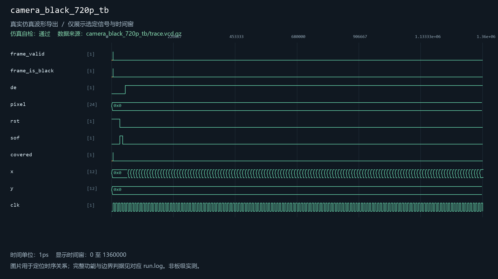
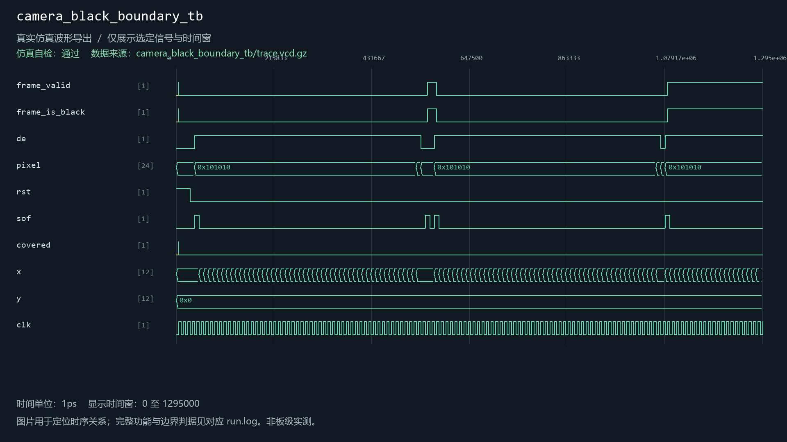
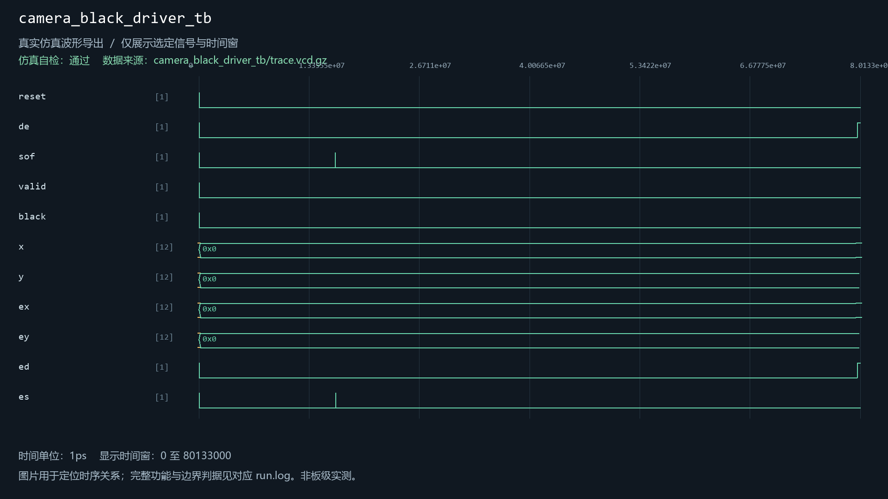
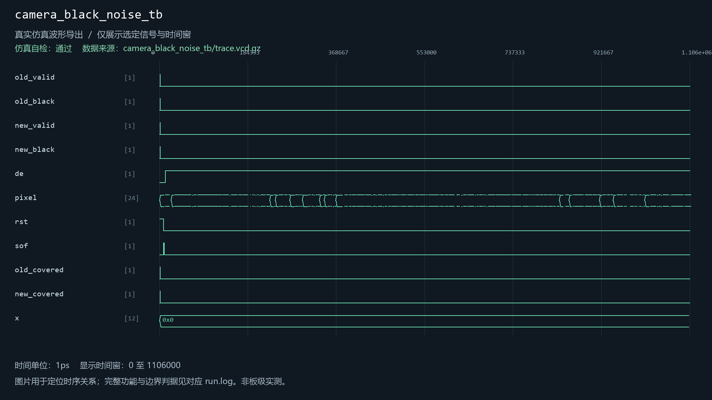
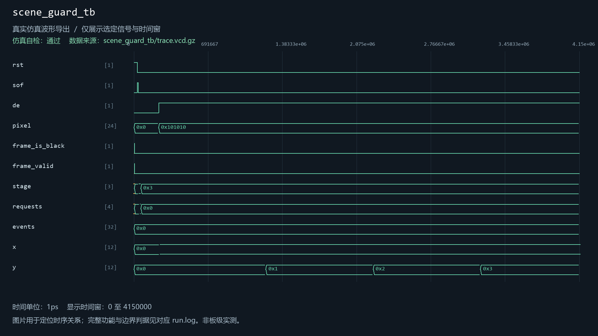

# camera_black_gate

当前工程实例化：是。关联5个自检用例。

| 用例 | 仿真器 | 当前结果 | 运行日志 | 结果记录 |
| --- | --- | --- | --- | --- |
| camera_black_720p_tb | icarus | 通过 | [日志](../../sim/results/quality_current/camera_black_720p_tb/run.log) | [记录](../../sim/results/quality_current/camera_black_720p_tb/result.json) |
| camera_black_boundary_tb | icarus | 通过 | [日志](../../sim/results/quality_current/camera_black_boundary_tb/run.log) | [记录](../../sim/results/quality_current/camera_black_boundary_tb/result.json) |
| camera_black_driver_tb | xsim | 通过 | [日志](../../sim/results/quality_current/camera_black_driver_tb/run.log) | [记录](../../sim/results/quality_current/camera_black_driver_tb/result.json) |
| camera_black_noise_tb | icarus | 通过 | [日志](../../sim/results/quality_current/camera_black_noise_tb/run.log) | [记录](../../sim/results/quality_current/camera_black_noise_tb/result.json) |
| scene_guard_tb | xsim | 通过 | [日志](../../sim/results/quality_current/scene_guard_tb/run.log) | [记录](../../sim/results/quality_current/scene_guard_tb/result.json) |

单独重跑本模块关联用例（工程根目录）：

```powershell
python sim/run_module_tests.py --only camera_black_720p_tb camera_black_boundary_tb camera_black_driver_tb camera_black_noise_tb scene_guard_tb --vivado-bin "$env:EXAMGUARD_VIVADO_BIN" --iverilog-bin "$env:EXAMGUARD_IVERILOG_BIN"
```

先按[复原说明](../../build/reproduction.md)配置工具。每次生成新的结果目录。

## camera_black_720p_tb

用例源码：[camera_black_720p_tb.sv](../../sim/sources/vision_guard/camera_black_720p_tb.sv)

历史VCD数据导出图（并非Vivado截图）：



## camera_black_boundary_tb

用例源码：[camera_black_boundary_tb.sv](../../sim/sources/vision_guard/camera_black_boundary_tb.sv)

历史VCD数据导出图（并非Vivado截图）：



## camera_black_driver_tb

用例源码：[camera_black_driver_tb.sv](../../sim/sources/vision_guard/camera_black_driver_tb.sv)

历史VCD数据导出图（并非Vivado截图）：



## camera_black_noise_tb

用例源码：[camera_black_noise_tb.sv](../../sim/sources/vision_guard/camera_black_noise_tb.sv)

历史VCD数据导出图（并非Vivado截图）：



## scene_guard_tb

用例源码：[scene_guard_tb.sv](../../sim/sources/vision_guard/scene_guard_tb.sv)

历史VCD数据导出图（并非Vivado截图）：


