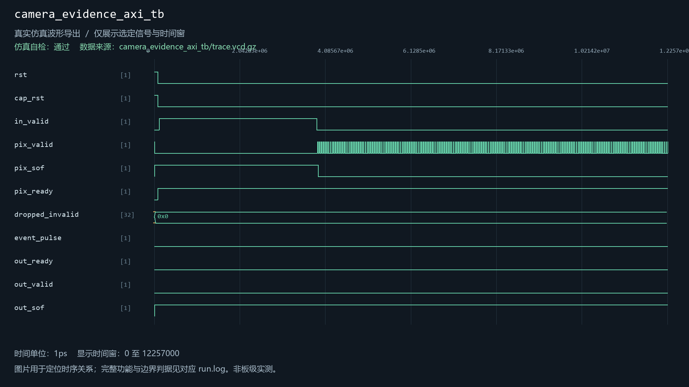
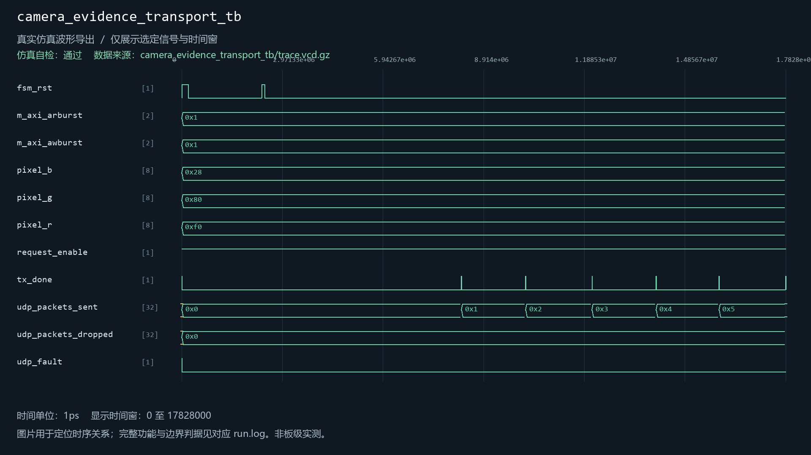
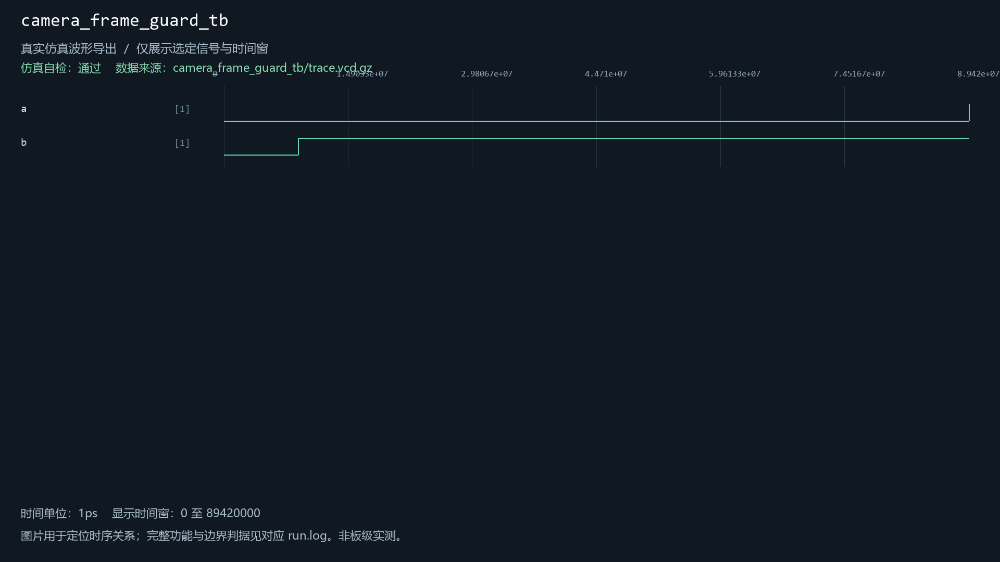
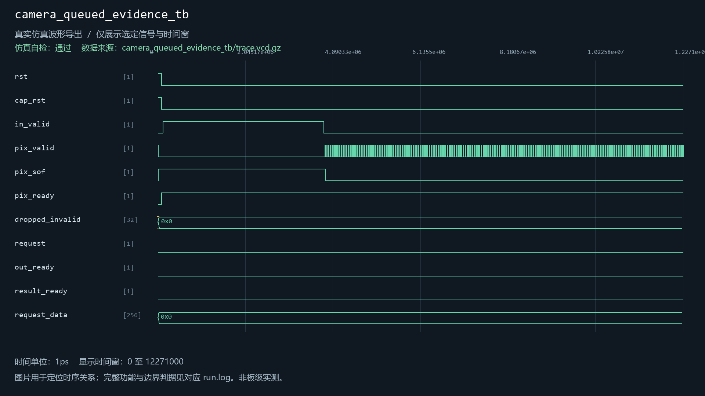
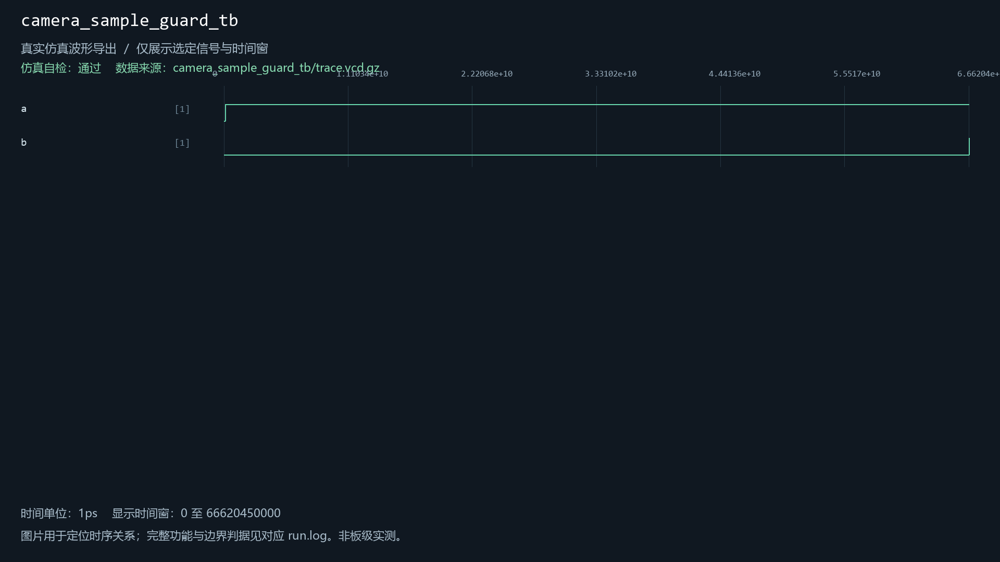
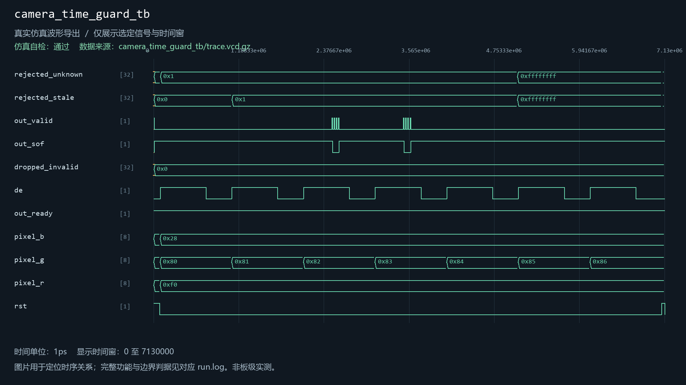
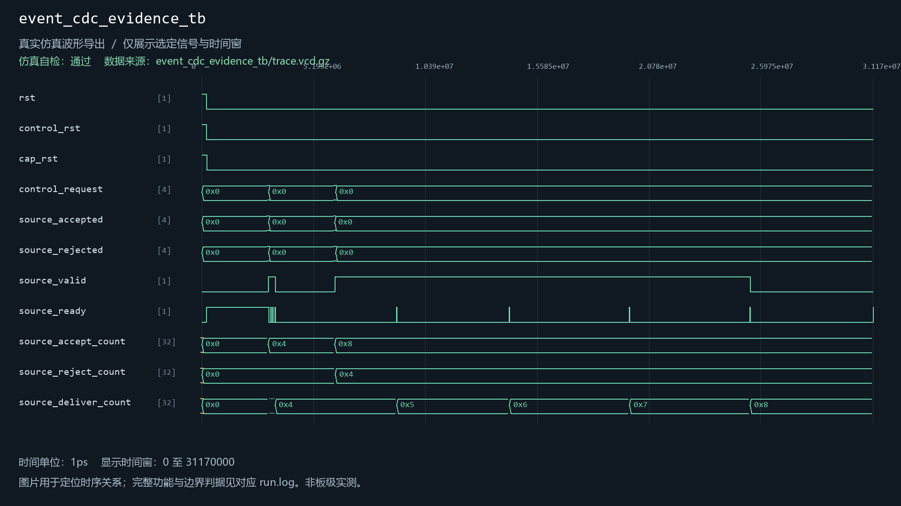
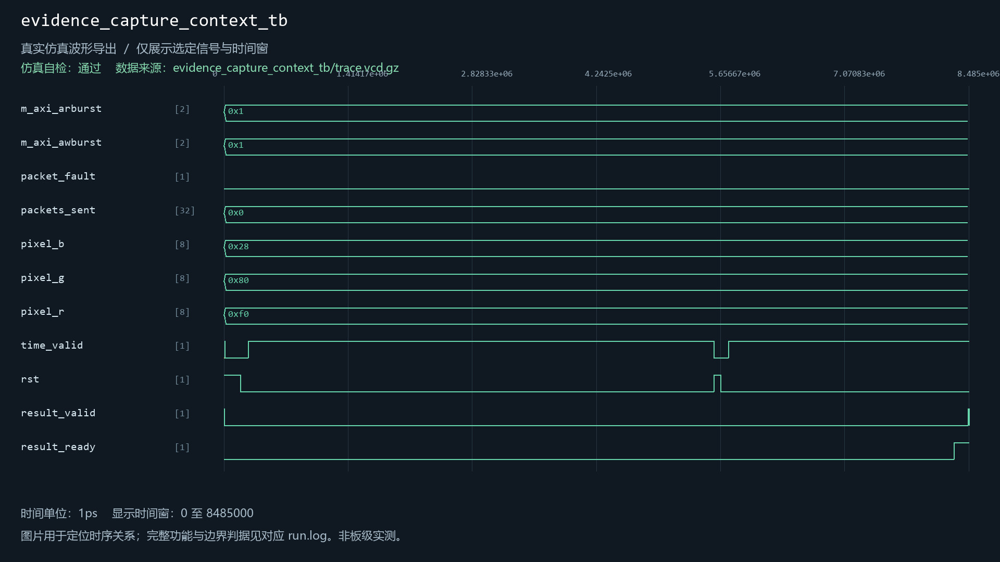

# camera_frame_guard

当前工程实例化：否。关联9个自检用例。

| 用例 | 仿真器 | 当前结果 | 运行日志 | 结果记录 |
| --- | --- | --- | --- | --- |
| camera_evidence_axi_tb | xsim | 通过 | [日志](../../sim/results/quality_current/camera_evidence_axi_tb/run.log) | [记录](../../sim/results/quality_current/camera_evidence_axi_tb/result.json) |
| camera_evidence_transport_tb | icarus | 通过 | [日志](../../sim/results/quality_current/camera_evidence_transport_tb/run.log) | [记录](../../sim/results/quality_current/camera_evidence_transport_tb/result.json) |
| camera_frame_guard_tb | xsim | 通过 | [日志](../../sim/results/quality_current/camera_frame_guard_tb/run.log) | [记录](../../sim/results/quality_current/camera_frame_guard_tb/result.json) |
| camera_queued_evidence_tb | xsim | 通过 | [日志](../../sim/results/quality_current/camera_queued_evidence_tb/run.log) | [记录](../../sim/results/quality_current/camera_queued_evidence_tb/result.json) |
| camera_sample_guard_tb | xsim | 通过 | [日志](../../sim/results/quality_current/camera_sample_guard_tb/run.log) | [记录](../../sim/results/quality_current/camera_sample_guard_tb/result.json) |
| camera_time_guard_tb | icarus | 通过 | [日志](../../sim/results/quality_current/camera_time_guard_tb/run.log) | [记录](../../sim/results/quality_current/camera_time_guard_tb/result.json) |
| event_cdc_evidence_tb | xsim | 通过 | [日志](../../sim/results/quality_current/event_cdc_evidence_tb/run.log) | [记录](../../sim/results/quality_current/event_cdc_evidence_tb/result.json) |
| evidence_capture_context_tb | icarus | 通过 | [日志](../../sim/results/quality_current/evidence_capture_context_tb/run.log) | [记录](../../sim/results/quality_current/evidence_capture_context_tb/result.json) |
| video_memory_fabric_tb | xsim | 通过 | [日志](../../sim/results/quality_current/video_memory_fabric_tb/run.log) | [记录](../../sim/results/quality_current/video_memory_fabric_tb/result.json) |

单独重跑本模块关联用例（工程根目录）：

```powershell
python sim/run_module_tests.py --only camera_evidence_axi_tb camera_evidence_transport_tb camera_frame_guard_tb camera_queued_evidence_tb camera_sample_guard_tb camera_time_guard_tb event_cdc_evidence_tb evidence_capture_context_tb video_memory_fabric_tb --vivado-bin "$env:EXAMGUARD_VIVADO_BIN" --iverilog-bin "$env:EXAMGUARD_IVERILOG_BIN"
```

先按[复原说明](../../build/reproduction.md)配置工具。每次生成新的结果目录。

## camera_evidence_axi_tb

用例源码：[camera_evidence_axi_tb.sv](../../sim/sources/ddr3_test/camera_evidence_axi_tb.sv), [axi_frame_slave_model.sv](../../sim/sources/ddr3_test/axi_frame_slave_model.sv)

历史VCD数据导出图（并非Vivado截图）：



## camera_evidence_transport_tb

用例源码：[camera_evidence_transport_tb.sv](../../sim/sources/ddr3_test/camera_evidence_transport_tb.sv), [axi_frame_slave_model.sv](../../sim/sources/ddr3_test/axi_frame_slave_model.sv)

历史VCD数据导出图（并非Vivado截图）：



## camera_frame_guard_tb

用例源码：[camera_frame_guard_tb.sv](../../sim/sources/ddr3_test/camera_frame_guard_tb.sv)

历史VCD数据导出图（并非Vivado截图）：



## camera_queued_evidence_tb

用例源码：[camera_queued_evidence_tb.sv](../../sim/sources/ddr3_test/camera_queued_evidence_tb.sv), [axi_frame_slave_model.sv](../../sim/sources/ddr3_test/axi_frame_slave_model.sv)

历史VCD数据导出图（并非Vivado截图）：



## camera_sample_guard_tb

用例源码：[camera_sample_guard_tb.sv](../../sim/sources/ddr3_test/camera_sample_guard_tb.sv)

历史VCD数据导出图（并非Vivado截图）：



## camera_time_guard_tb

用例源码：[camera_time_guard_tb.sv](../../sim/sources/ddr3_test/camera_time_guard_tb.sv)

历史VCD数据导出图（并非Vivado截图）：



## event_cdc_evidence_tb

用例源码：[event_cdc_evidence_tb.sv](../../sim/sources/ddr3_test/event_cdc_evidence_tb.sv), [axi_frame_slave_model.sv](../../sim/sources/ddr3_test/axi_frame_slave_model.sv)

历史VCD数据导出图（并非Vivado截图）：



## evidence_capture_context_tb

用例源码：[evidence_capture_context_tb.sv](../../sim/sources/ddr3_test/evidence_capture_context_tb.sv), [axi_frame_slave_model.sv](../../sim/sources/ddr3_test/axi_frame_slave_model.sv), [evidence_capture_context.v](../../sim/sources/ddr3_test/evidence_capture_context.v), [evidence_reset_epoch.v](../../sim/sources/event_identity/evidence_reset_epoch.v)

历史VCD数据导出图（并非Vivado截图）：



## video_memory_fabric_tb

用例源码：[video_memory_fabric_tb.sv](../../sim/sources/ddr3_test/video_memory_fabric_tb.sv), [axi_frame_slave_model.sv](../../sim/sources/ddr3_test/axi_frame_slave_model.sv)

历史VCD数据导出图（并非Vivado截图）：


