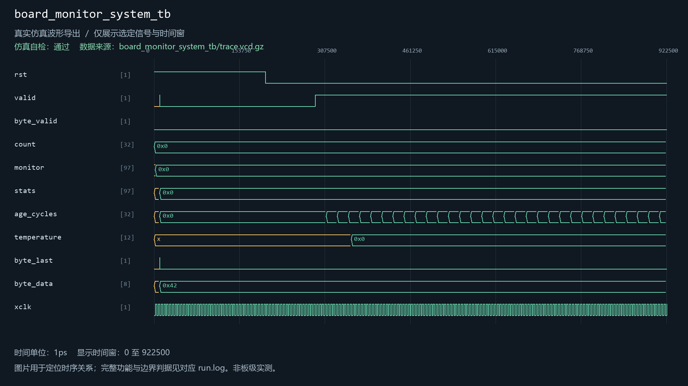
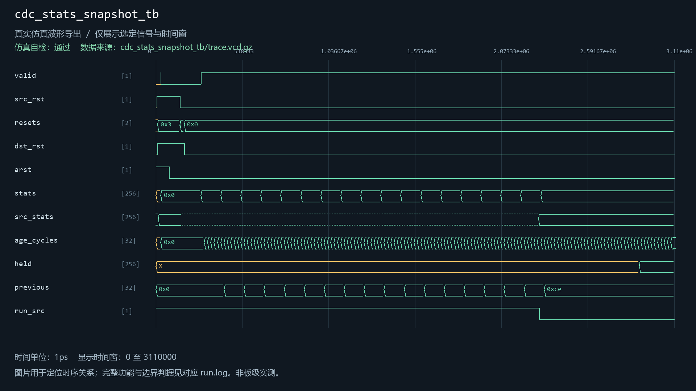
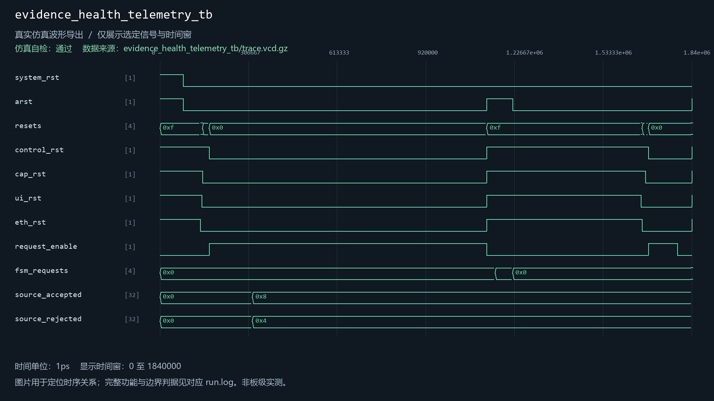
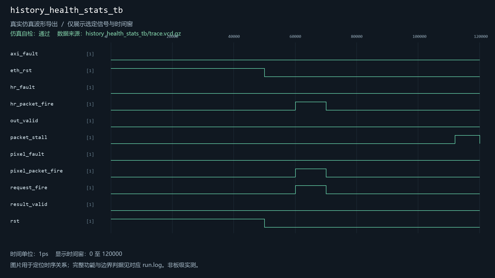
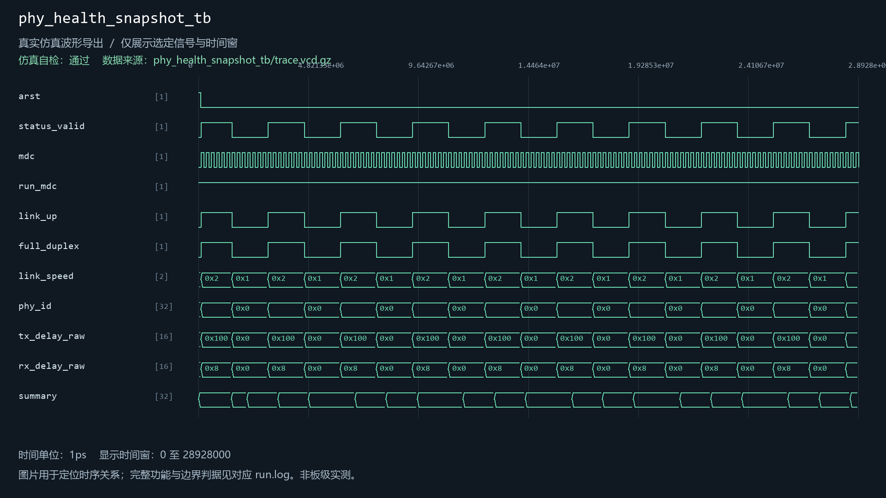
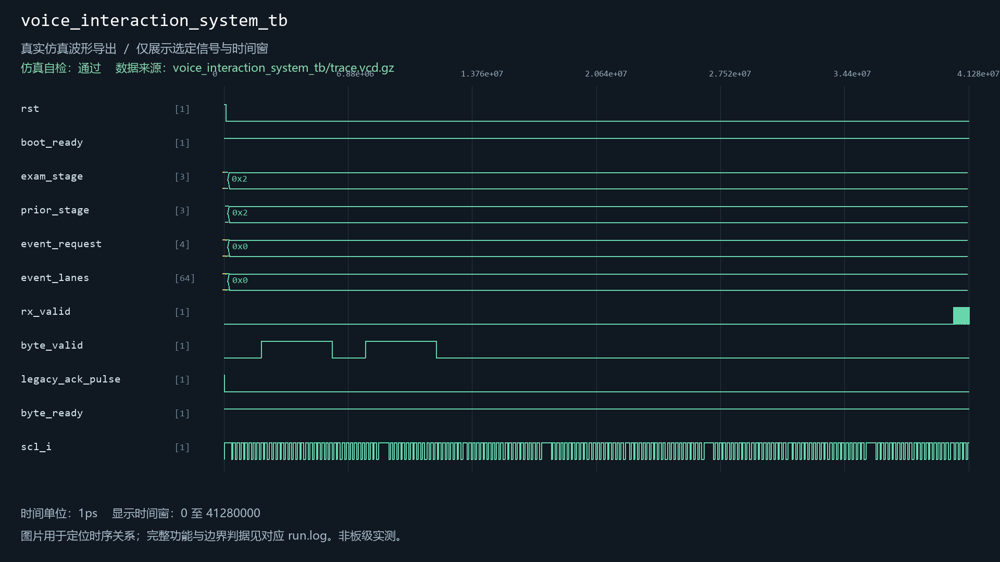

# cdc_stats_snapshot

当前工程实例化：是。关联7个自检用例。

| 用例 | 仿真器 | 当前结果 | 运行日志 | 结果记录 |
| --- | --- | --- | --- | --- |
| board_monitor_system_tb | xsim | 通过 | [日志](../../sim/results/quality_current/board_monitor_system_tb/run.log) | [记录](../../sim/results/quality_current/board_monitor_system_tb/result.json) |
| camera_evidence_transport_tb | icarus | 通过 | [日志](../../sim/results/quality_current/camera_evidence_transport_tb/run.log) | [记录](../../sim/results/quality_current/camera_evidence_transport_tb/result.json) |
| cdc_stats_snapshot_tb | icarus | 通过 | [日志](../../sim/results/quality_current/cdc_stats_snapshot_tb/run.log) | [记录](../../sim/results/quality_current/cdc_stats_snapshot_tb/result.json) |
| evidence_health_telemetry_tb | xsim | 通过 | [日志](../../sim/results/quality_current/evidence_health_telemetry_tb/run.log) | [记录](../../sim/results/quality_current/evidence_health_telemetry_tb/result.json) |
| history_health_stats_tb | icarus | 通过 | [日志](../../sim/results/quality_current/history_health_stats_tb/run.log) | [记录](../../sim/results/quality_current/history_health_stats_tb/result.json) |
| phy_health_snapshot_tb | xsim | 通过 | [日志](../../sim/results/quality_current/phy_health_snapshot_tb/run.log) | [记录](../../sim/results/quality_current/phy_health_snapshot_tb/result.json) |
| voice_interaction_system_tb | xsim | 通过 | [日志](../../sim/results/quality_current/voice_interaction_system_tb/run.log) | [记录](../../sim/results/quality_current/voice_interaction_system_tb/result.json) |

单独重跑本模块关联用例（工程根目录）：

```powershell
python sim/run_module_tests.py --only board_monitor_system_tb camera_evidence_transport_tb cdc_stats_snapshot_tb evidence_health_telemetry_tb history_health_stats_tb phy_health_snapshot_tb voice_interaction_system_tb --vivado-bin "$env:EXAMGUARD_VIVADO_BIN" --iverilog-bin "$env:EXAMGUARD_IVERILOG_BIN"
```

先按[复原说明](../../build/reproduction.md)配置工具。每次生成新的结果目录。

## board_monitor_system_tb

用例源码：[board_monitor_system_tb.sv](../../sim/test_repairs/board_monitor_system_tb/board_monitor_system_tb.sv)

VCD仿真波形（来源批次见索引）：



## camera_evidence_transport_tb

用例源码：[camera_evidence_transport_tb.sv](../../sim/sources/ddr3_test/camera_evidence_transport_tb.sv), [axi_frame_slave_model.sv](../../sim/sources/ddr3_test/axi_frame_slave_model.sv)

VCD仿真波形（来源批次见索引）：


## cdc_stats_snapshot_tb

用例源码：[cdc_stats_snapshot_tb.sv](../../sim/sources/health/cdc_stats_snapshot_tb.sv)

VCD仿真波形（来源批次见索引）：



## evidence_health_telemetry_tb

用例源码：[evidence_health_telemetry_tb.sv](../../sim/sources/health/evidence_health_telemetry_tb.sv)

VCD仿真波形（来源批次见索引）：



## history_health_stats_tb

用例源码：[history_health_stats_tb.sv](../../sim/sources/health/history_health_stats_tb.sv)

VCD仿真波形（来源批次见索引）：



## phy_health_snapshot_tb

用例源码：[phy_health_snapshot_tb.sv](../../sim/sources/health/phy_health_snapshot_tb.sv)

VCD仿真波形（来源批次见索引）：



## voice_interaction_system_tb

用例源码：[voice_interaction_system_tb.sv](../../sim/sources/voice_interaction/voice_interaction_system_tb.sv), [wonderecho_wire_model.sv](../../sim/sources/voice_interaction/wonderecho_wire_model.sv)

VCD仿真波形（来源批次见索引）：


