# ddr3_axi_frame_dma

当前工程实例化：是。关联20个自检用例。

| 用例 | 仿真器 | 当前结果 | 运行日志 | 结果记录 |
| --- | --- | --- | --- | --- |
| camera_evidence_axi_tb | xsim | 通过 | [日志](../../sim/results/quality_current/camera_evidence_axi_tb/run.log) | [记录](../../sim/results/quality_current/camera_evidence_axi_tb/result.json) |
| camera_evidence_transport_tb | icarus | 通过 | [日志](../../sim/results/quality_current/camera_evidence_transport_tb/run.log) | [记录](../../sim/results/quality_current/camera_evidence_transport_tb/result.json) |
| camera_queued_evidence_tb | xsim | 通过 | [日志](../../sim/results/quality_current/camera_queued_evidence_tb/run.log) | [记录](../../sim/results/quality_current/camera_queued_evidence_tb/result.json) |
| ddr3_axi_frame_dma_tb | icarus | 通过 | [日志](../../sim/results/quality_current/ddr3_axi_frame_dma_tb/run.log) | [记录](../../sim/results/quality_current/ddr3_axi_frame_dma_tb/result.json) |
| ddr_evidence_axi_tb | icarus | 通过 | [日志](../../sim/results/quality_current/ddr_evidence_axi_tb/run.log) | [记录](../../sim/results/quality_current/ddr_evidence_axi_tb/result.json) |
| ddr_evidence_probe_tb | icarus | 通过 | [日志](../../sim/results/quality_current/ddr_evidence_probe_tb/run.log) | [记录](../../sim/results/quality_current/ddr_evidence_probe_tb/result.json) |
| ddr_evidence_queued_tb | xsim | 通过 | [日志](../../sim/results/quality_current/ddr_evidence_queued_tb/run.log) | [记录](../../sim/results/quality_current/ddr_evidence_queued_tb/result.json) |
| event_cdc_evidence_tb | xsim | 通过 | [日志](../../sim/results/quality_current/event_cdc_evidence_tb/run.log) | [记录](../../sim/results/quality_current/event_cdc_evidence_tb/result.json) |
| evidence_capture_context_tb | icarus | 通过 | [日志](../../sim/results/quality_current/evidence_capture_context_tb/run.log) | [记录](../../sim/results/quality_current/evidence_capture_context_tb/result.json) |
| history_capture_client_tb | icarus | 通过 | [日志](../../sim/results/quality_current/history_capture_client_tb/run.log) | [记录](../../sim/results/quality_current/history_capture_client_tb/result.json) |
| history_capture_pipeline_tb | icarus | 通过 | [日志](../../sim/results/quality_current/history_capture_pipeline_tb/run.log) | [记录](../../sim/results/quality_current/history_capture_pipeline_tb/result.json) |
| history_frame_writer_tb | xsim | 通过 | [日志](../../sim/results/quality_current/history_frame_writer_tb/run.log) | [记录](../../sim/results/quality_current/history_frame_writer_tb/result.json) |
| history_ordered_ingress_tb | icarus | 通过 | [日志](../../sim/results/quality_current/history_ordered_ingress_tb/run.log) | [记录](../../sim/results/quality_current/history_ordered_ingress_tb/result.json) |
| history_scheduler_tb | icarus | 通过 | [日志](../../sim/results/quality_current/history_scheduler_tb/run.log) | [记录](../../sim/results/quality_current/history_scheduler_tb/result.json) |
| history_shared_read_tb | xsim | 通过 | [日志](../../sim/results/quality_current/history_shared_read_tb/run.log) | [记录](../../sim/results/quality_current/history_shared_read_tb/result.json) |
| history_store_axi_tb | xsim | 通过 | [日志](../../sim/results/quality_current/history_store_axi_tb/run.log) | [记录](../../sim/results/quality_current/history_store_axi_tb/result.json) |
| history_window_reader_tb | xsim | 通过 | [日志](../../sim/results/quality_current/history_window_reader_tb/run.log) | [记录](../../sim/results/quality_current/history_window_reader_tb/result.json) |
| queued_window_packet_tb | xsim | 通过 | [日志](../../sim/results/quality_current/queued_window_packet_tb/run.log) | [记录](../../sim/results/quality_current/queued_window_packet_tb/result.json) |
| shared_evidence_axi_tb | xsim | 通过 | [日志](../../sim/results/quality_current/shared_evidence_axi_tb/run.log) | [记录](../../sim/results/quality_current/shared_evidence_axi_tb/result.json) |
| video_memory_fabric_tb | xsim | 通过 | [日志](../../sim/results/quality_current/video_memory_fabric_tb/run.log) | [记录](../../sim/results/quality_current/video_memory_fabric_tb/result.json) |

单独重跑本模块关联用例（工程根目录）：

```powershell
python sim/run_module_tests.py --only camera_evidence_axi_tb camera_evidence_transport_tb camera_queued_evidence_tb ddr3_axi_frame_dma_tb ddr_evidence_axi_tb ddr_evidence_probe_tb ddr_evidence_queued_tb event_cdc_evidence_tb evidence_capture_context_tb history_capture_client_tb history_capture_pipeline_tb history_frame_writer_tb history_ordered_ingress_tb history_scheduler_tb history_shared_read_tb history_store_axi_tb history_window_reader_tb queued_window_packet_tb shared_evidence_axi_tb video_memory_fabric_tb --vivado-bin "$env:EXAMGUARD_VIVADO_BIN" --iverilog-bin "$env:EXAMGUARD_IVERILOG_BIN"
```

先按[复原说明](../../build/reproduction.md)配置工具。每次生成新的结果目录。

## camera_evidence_axi_tb

用例源码：[camera_evidence_axi_tb.sv](../../sim/sources/ddr3_test/camera_evidence_axi_tb.sv), [axi_frame_slave_model.sv](../../sim/sources/ddr3_test/axi_frame_slave_model.sv)

VCD仿真波形（来源批次见索引）：

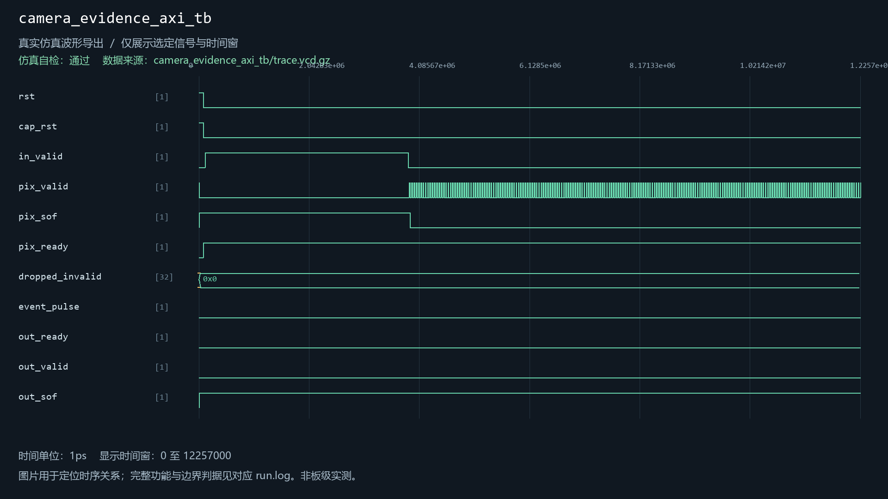

## camera_evidence_transport_tb

用例源码：[camera_evidence_transport_tb.sv](../../sim/sources/ddr3_test/camera_evidence_transport_tb.sv), [axi_frame_slave_model.sv](../../sim/sources/ddr3_test/axi_frame_slave_model.sv)

VCD仿真波形（来源批次见索引）：


## camera_queued_evidence_tb

用例源码：[camera_queued_evidence_tb.sv](../../sim/sources/ddr3_test/camera_queued_evidence_tb.sv), [axi_frame_slave_model.sv](../../sim/sources/ddr3_test/axi_frame_slave_model.sv)

VCD仿真波形（来源批次见索引）：

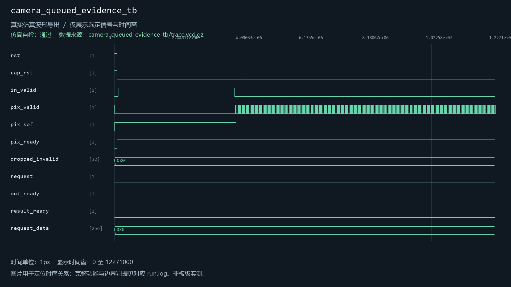

## ddr3_axi_frame_dma_tb

用例源码：[ddr3_axi_frame_dma_tb.sv](../../sim/sources/ddr3_test/ddr3_axi_frame_dma_tb.sv), [axi_frame_slave_model.sv](../../sim/sources/ddr3_test/axi_frame_slave_model.sv)

VCD仿真波形（来源批次见索引）：

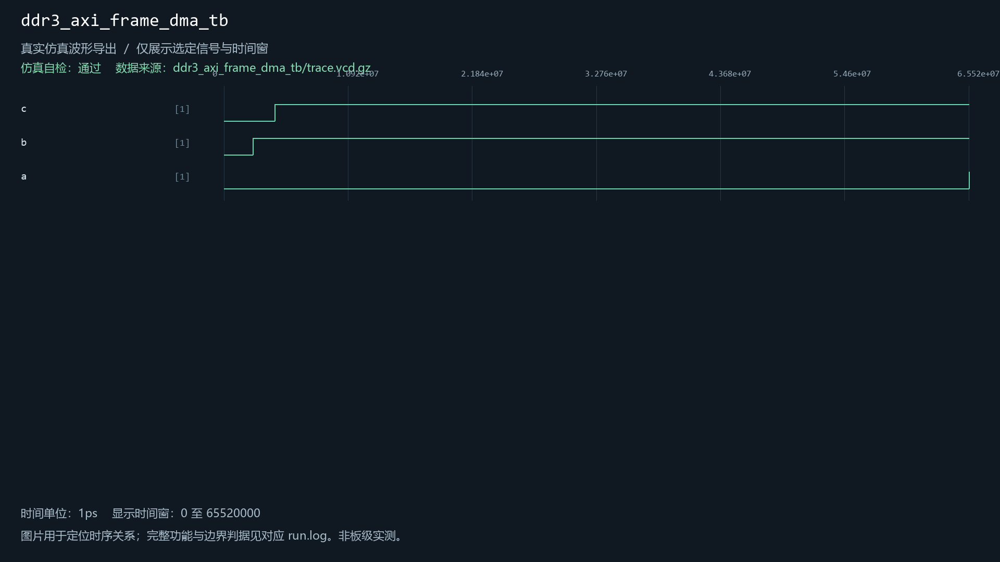

## ddr_evidence_axi_tb

用例源码：[ddr_evidence_axi_tb.sv](../../sim/sources/ddr3_test/ddr_evidence_axi_tb.sv), [axi_frame_slave_model.sv](../../sim/sources/ddr3_test/axi_frame_slave_model.sv)

VCD仿真波形（来源批次见索引）：

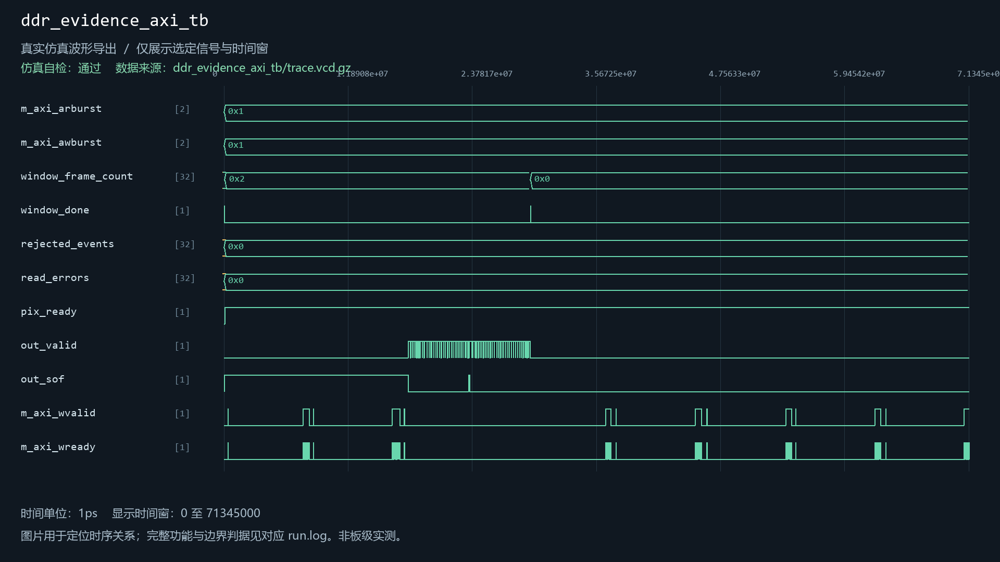

## ddr_evidence_probe_tb

用例源码：[ddr_evidence_probe_tb.sv](../../sim/sources/ddr3_test/ddr_evidence_probe_tb.sv), [axi_frame_slave_model.sv](../../sim/sources/ddr3_test/axi_frame_slave_model.sv), [ddr_evidence_probe.v](../../sim/sources/ddr3_test/ddr_evidence_probe.v)

VCD仿真波形（来源批次见索引）：

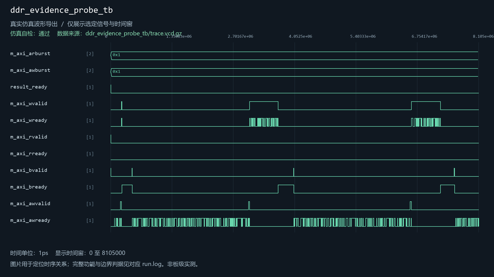

## ddr_evidence_queued_tb

用例源码：[ddr_evidence_queued_tb.sv](../../sim/sources/ddr3_test/ddr_evidence_queued_tb.sv), [axi_frame_slave_model.sv](../../sim/sources/ddr3_test/axi_frame_slave_model.sv)

Vivado原生波形（与所列用例及WDB对应）：

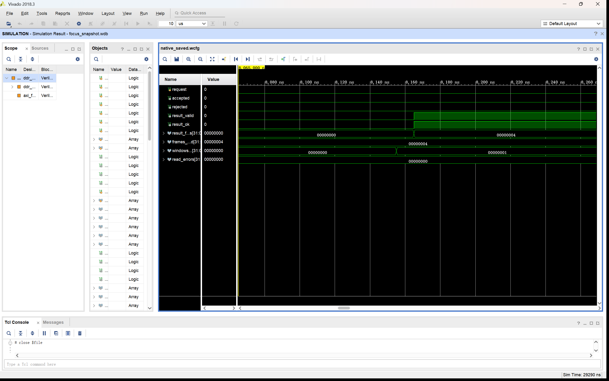

[原始WDB](../../sim/native_databases/ddr_evidence_queued_tb/focus_snapshot.wdb)

VCD仿真波形（来源批次见索引）：

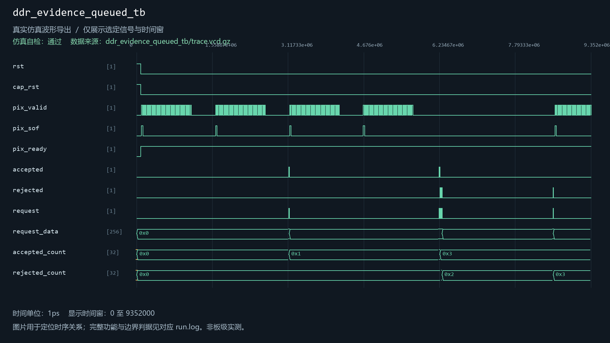

## event_cdc_evidence_tb

用例源码：[event_cdc_evidence_tb.sv](../../sim/sources/ddr3_test/event_cdc_evidence_tb.sv), [axi_frame_slave_model.sv](../../sim/sources/ddr3_test/axi_frame_slave_model.sv)

VCD仿真波形（来源批次见索引）：

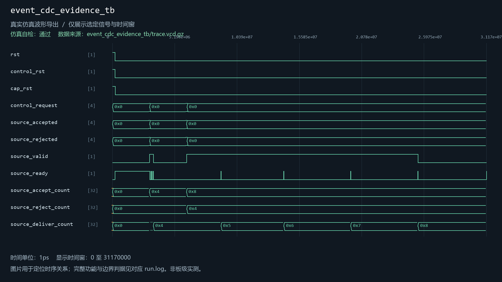

## evidence_capture_context_tb

用例源码：[evidence_capture_context_tb.sv](../../sim/sources/ddr3_test/evidence_capture_context_tb.sv), [axi_frame_slave_model.sv](../../sim/sources/ddr3_test/axi_frame_slave_model.sv), [evidence_capture_context.v](../../sim/sources/ddr3_test/evidence_capture_context.v), [evidence_reset_epoch.v](../../sim/sources/event_identity/evidence_reset_epoch.v)

VCD仿真波形（来源批次见索引）：

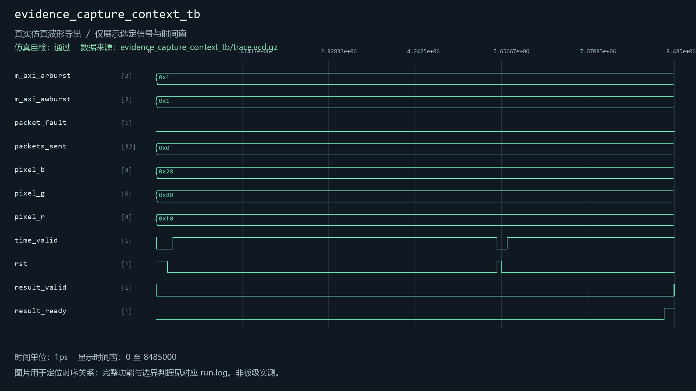

## history_capture_client_tb

用例源码：[history_capture_client_tb.sv](../../sim/sources/ddr3_test/history_capture_client_tb.sv), [axi_frame_slave_model.sv](../../sim/sources/ddr3_test/axi_frame_slave_model.sv)

VCD仿真波形（来源批次见索引）：


## history_capture_pipeline_tb

用例源码：[history_capture_pipeline_tb.sv](../../sim/sources/ddr3_test/history_capture_pipeline_tb.sv), [axi_frame_slave_model.sv](../../sim/sources/ddr3_test/axi_frame_slave_model.sv)

VCD仿真波形（来源批次见索引）：

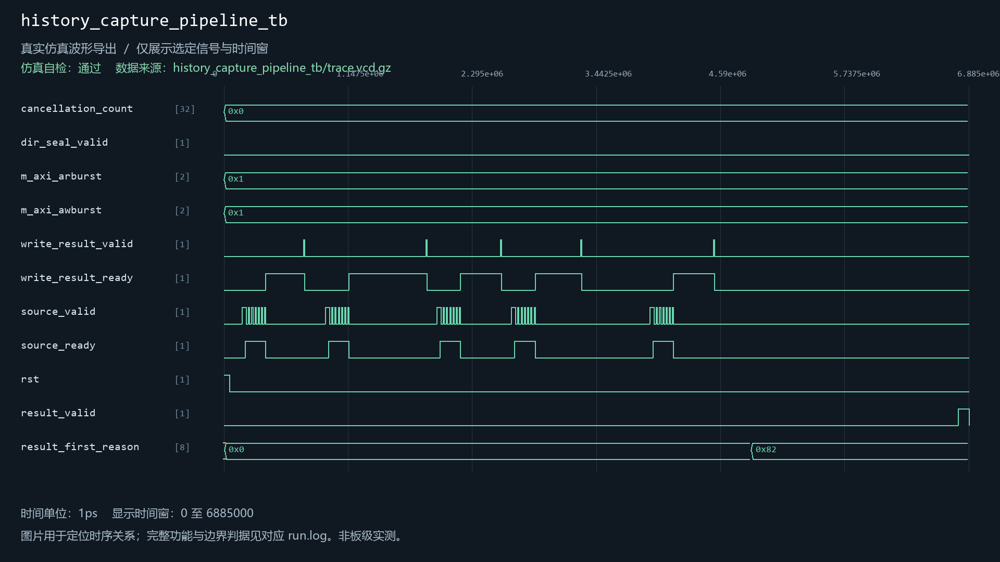

## history_frame_writer_tb

用例源码：[history_frame_writer_tb.sv](../../sim/test_repairs/history_frame_writer_tb/history_frame_writer_tb.sv), [axi_frame_slave_model.sv](../../sim/sources/ddr3_test/axi_frame_slave_model.sv)

VCD仿真波形（来源批次见索引）：

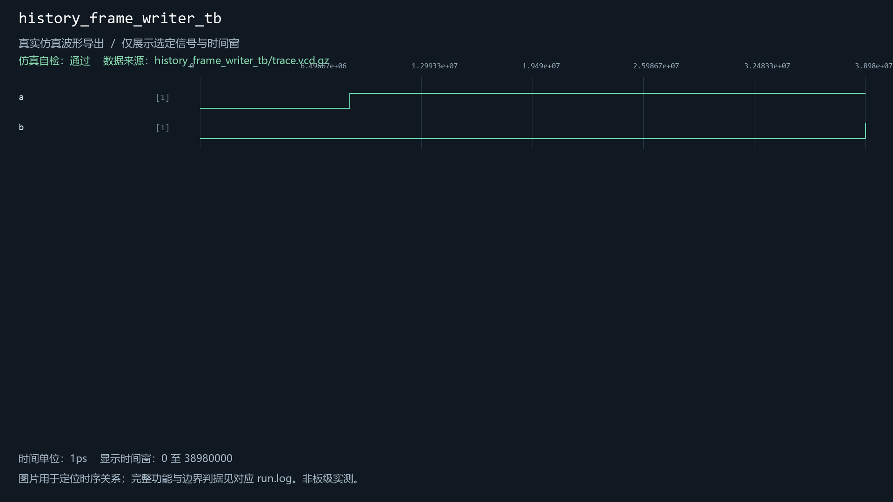

## history_ordered_ingress_tb

用例源码：[history_ordered_ingress_tb.sv](../../sim/sources/ddr3_test/history_ordered_ingress_tb.sv), [axi_frame_slave_model.sv](../../sim/sources/ddr3_test/axi_frame_slave_model.sv)

VCD仿真波形（来源批次见索引）：

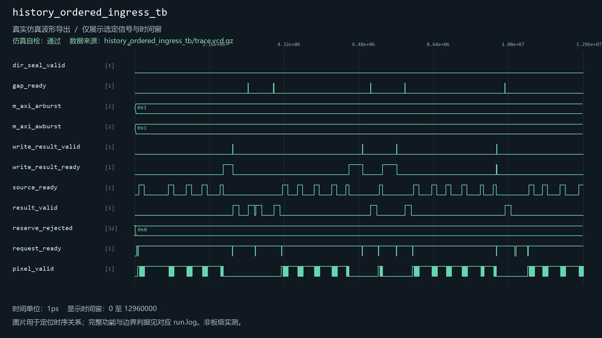

## history_scheduler_tb

用例源码：[history_scheduler_tb.sv](../../sim/sources/ddr3_test/history_scheduler_tb.sv), [axi_frame_slave_model.sv](../../sim/sources/ddr3_test/axi_frame_slave_model.sv)

VCD仿真波形（来源批次见索引）：

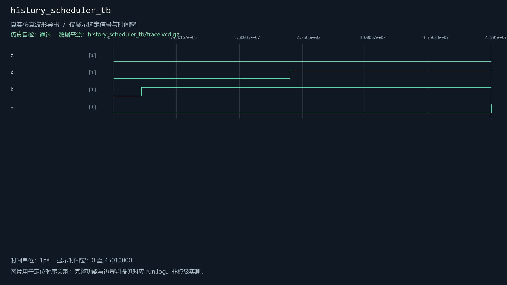

## history_shared_read_tb

用例源码：[history_shared_read_tb.sv](../../sim/test_repairs/history_shared_read_tb/history_shared_read_tb.sv), [axi_frame_slave_model.sv](../../sim/sources/ddr3_test/axi_frame_slave_model.sv)

VCD仿真波形（来源批次见索引）：

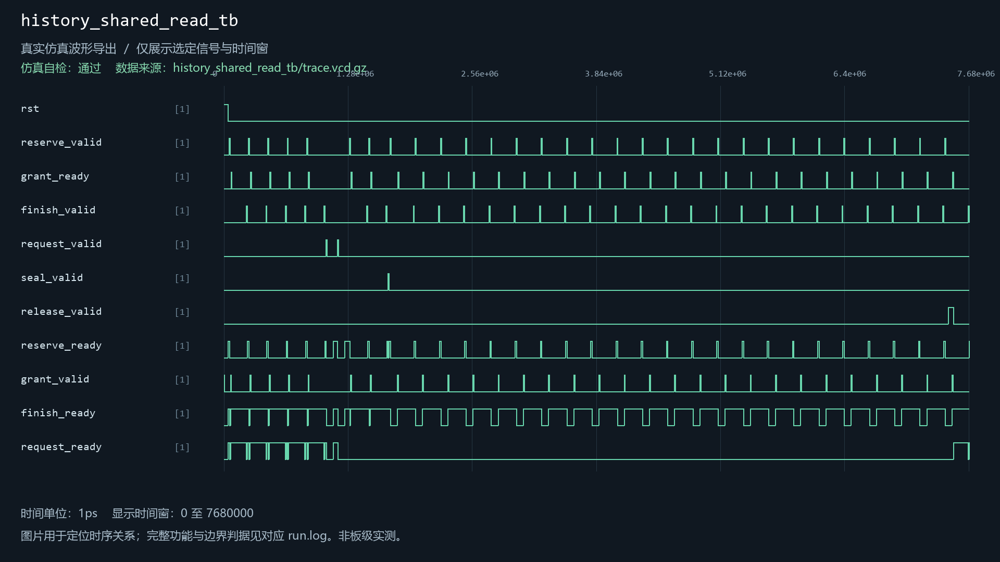

## history_store_axi_tb

用例源码：[history_store_axi_tb.sv](../../sim/sources/ddr3_test/history_store_axi_tb.sv), [axi_frame_slave_model.sv](../../sim/sources/ddr3_test/axi_frame_slave_model.sv)

Vivado原生波形（与所列用例及WDB对应）：

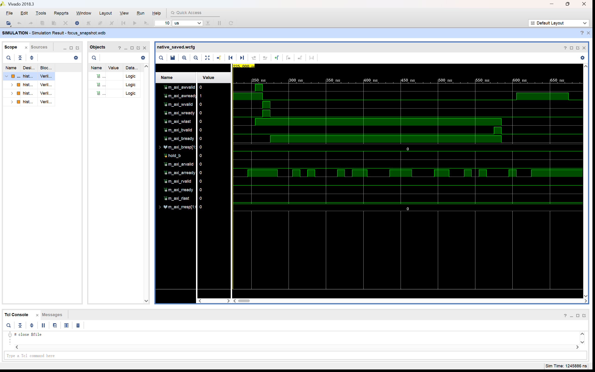

[原始WDB](../../sim/native_databases/history_store_axi_tb/focus_snapshot.wdb)

VCD仿真波形（来源批次见索引）：

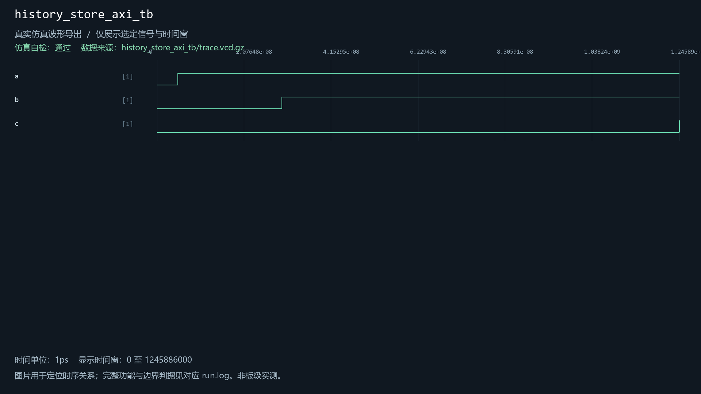

## history_window_reader_tb

用例源码：[history_window_reader_tb.sv](../../sim/test_repairs/history_window_reader_tb/history_window_reader_tb.sv), [axi_frame_slave_model.sv](../../sim/sources/ddr3_test/axi_frame_slave_model.sv)

VCD仿真波形（来源批次见索引）：

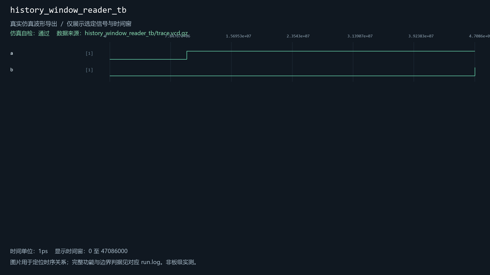

## queued_window_packet_tb

用例源码：[queued_window_packet_tb.sv](../../sim/sources/ddr3_test/queued_window_packet_tb.sv), [axi_frame_slave_model.sv](../../sim/sources/ddr3_test/axi_frame_slave_model.sv)

VCD仿真波形（来源批次见索引）：

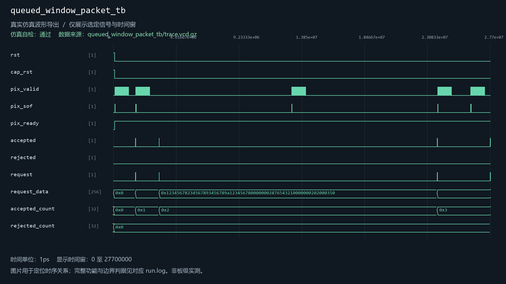

## shared_evidence_axi_tb

用例源码：[shared_evidence_axi_tb.sv](../../sim/sources/ddr3_test/shared_evidence_axi_tb.sv), [axi_frame_slave_model.sv](../../sim/sources/ddr3_test/axi_frame_slave_model.sv), [video_fifo_path_source.sv](../../sim/sources/ddr3_test/video_fifo_path_source.sv), [axi_2client_arbiter_tb.sv](../../sim/sources/ddr3_test/axi_2client_arbiter_tb.sv)

VCD仿真波形（来源批次见索引）：

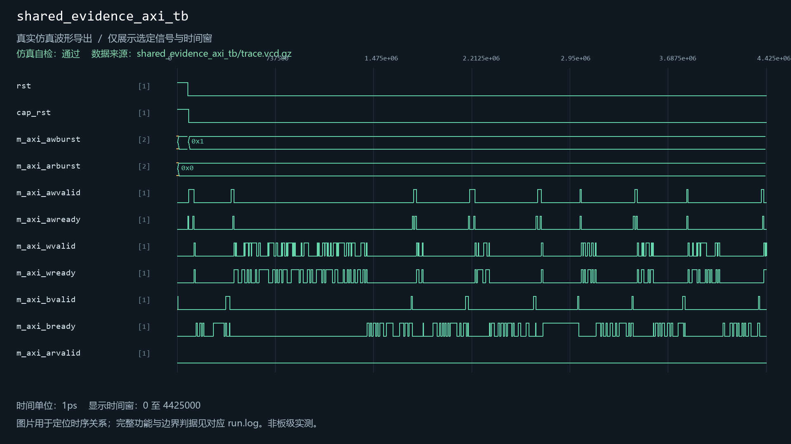

## video_memory_fabric_tb

用例源码：[video_memory_fabric_tb.sv](../../sim/sources/ddr3_test/video_memory_fabric_tb.sv), [axi_frame_slave_model.sv](../../sim/sources/ddr3_test/axi_frame_slave_model.sv)

VCD仿真波形（来源批次见索引）：


