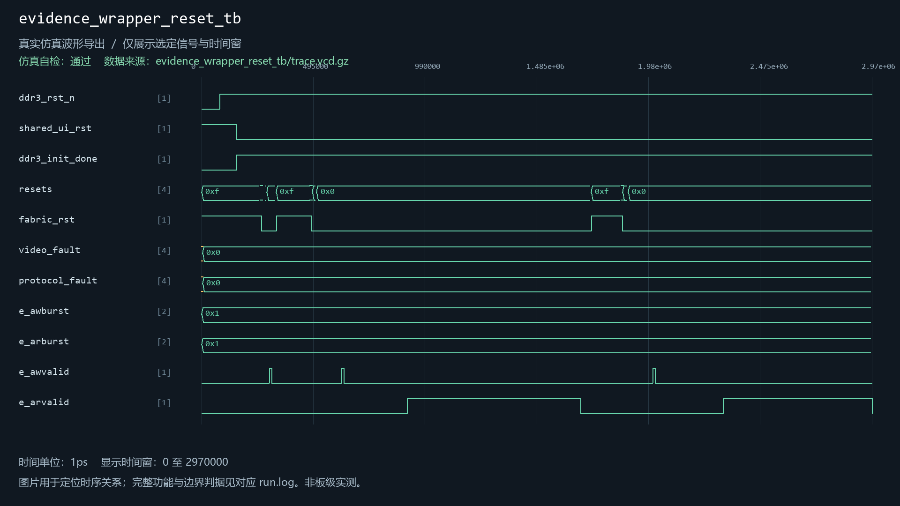

# ddr3_shared_video_ctrl

当前工程实例化：是。关联1个自检用例。

| 用例 | 仿真器 | 当前结果 | 运行日志 | 结果记录 |
| --- | --- | --- | --- | --- |
| evidence_wrapper_reset_tb | xsim | 通过 | [日志](../../sim/results/quality_current/evidence_wrapper_reset_tb/run.log) | [记录](../../sim/results/quality_current/evidence_wrapper_reset_tb/result.json) |

单独重跑本模块关联用例（工程根目录）：

```powershell
python sim/run_module_tests.py --only evidence_wrapper_reset_tb --vivado-bin "$env:EXAMGUARD_VIVADO_BIN" --iverilog-bin "$env:EXAMGUARD_IVERILOG_BIN"
```

先按[复原说明](../../build/reproduction.md)配置工具。每次生成新的结果目录。

## evidence_wrapper_reset_tb

用例源码：[evidence_wrapper_reset_tb.sv](../../sim/test_repairs/evidence_wrapper_reset_tb/evidence_wrapper_reset_tb.sv), [axi_frame_slave_model.sv](../../sim/sources/ddr3_test/axi_frame_slave_model.sv), [mig_axi_reset_contract_model.sv](../../sim/test_repairs/evidence_wrapper_reset_tb/mig_axi_reset_contract_model.sv)

VCD仿真波形（来源批次见索引）：


