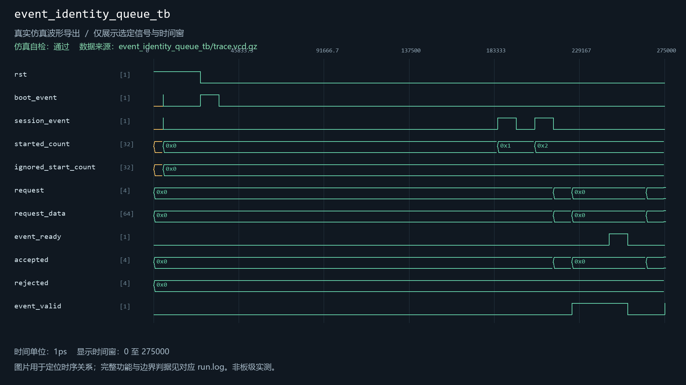
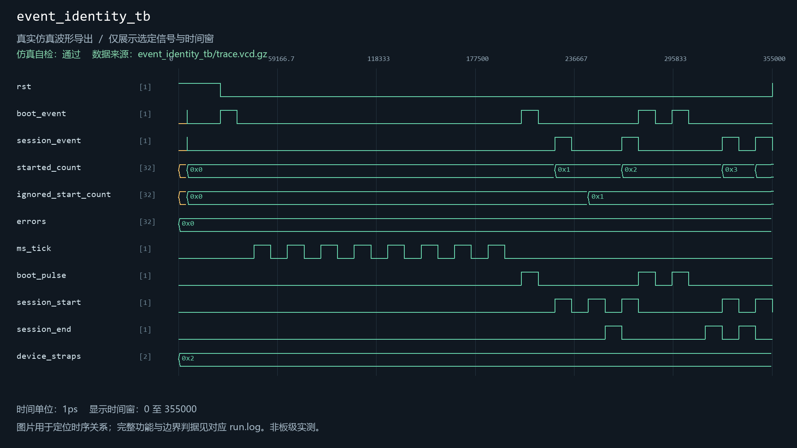
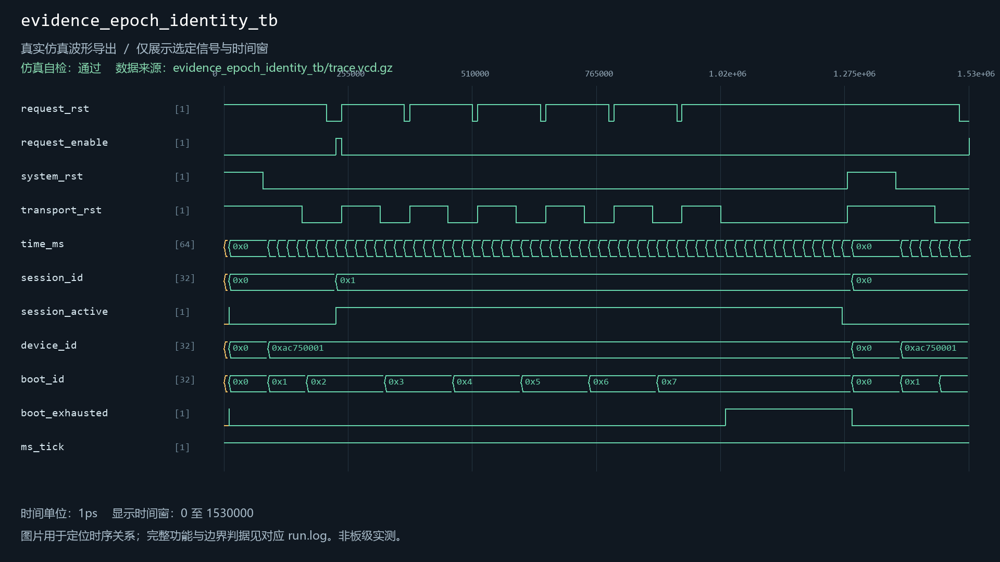
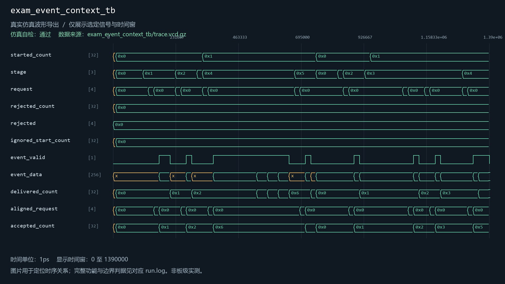
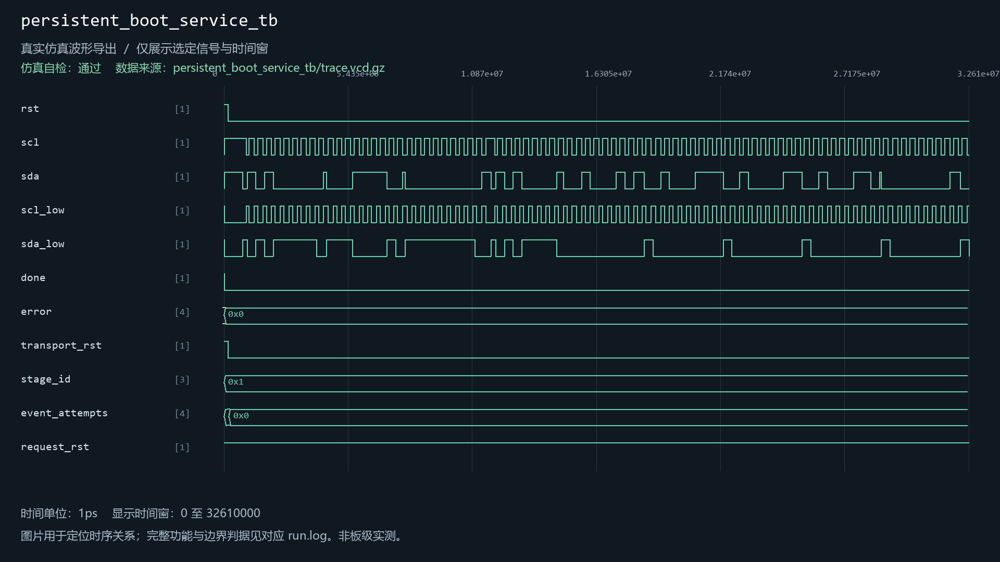
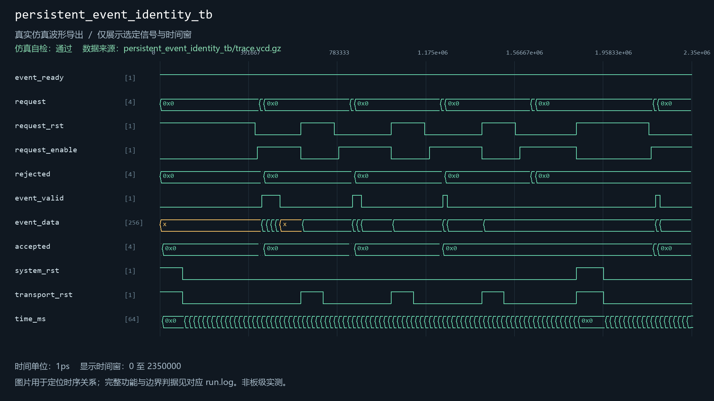

# event_identity

当前工程实例化：是。关联8个自检用例。

| 用例 | 仿真器 | 当前结果 | 运行日志 | 结果记录 |
| --- | --- | --- | --- | --- |
| camera_evidence_transport_tb | icarus | 通过 | [日志](../../sim/results/quality_current/camera_evidence_transport_tb/run.log) | [记录](../../sim/results/quality_current/camera_evidence_transport_tb/result.json) |
| event_identity_queue_tb | xsim | 通过 | [日志](../../sim/results/quality_current/event_identity_queue_tb/run.log) | [记录](../../sim/results/quality_current/event_identity_queue_tb/result.json) |
| event_identity_tb | xsim | 通过 | [日志](../../sim/results/quality_current/event_identity_tb/run.log) | [记录](../../sim/results/quality_current/event_identity_tb/result.json) |
| evidence_epoch_identity_tb | icarus | 通过 | [日志](../../sim/results/quality_current/evidence_epoch_identity_tb/run.log) | [记录](../../sim/results/quality_current/evidence_epoch_identity_tb/result.json) |
| exam_event_context_tb | icarus | 通过 | [日志](../../sim/results/quality_current/exam_event_context_tb/run.log) | [记录](../../sim/results/quality_current/exam_event_context_tb/result.json) |
| history_capture_client_tb | icarus | 通过 | [日志](../../sim/results/quality_current/history_capture_client_tb/run.log) | [记录](../../sim/results/quality_current/history_capture_client_tb/result.json) |
| persistent_boot_service_tb | xsim | 通过 | [日志](../../sim/results/quality_current/persistent_boot_service_tb/run.log) | [记录](../../sim/results/quality_current/persistent_boot_service_tb/result.json) |
| persistent_event_identity_tb | icarus | 通过 | [日志](../../sim/results/quality_current/persistent_event_identity_tb/run.log) | [记录](../../sim/results/quality_current/persistent_event_identity_tb/result.json) |

单独重跑本模块关联用例（工程根目录）：

```powershell
python sim/run_module_tests.py --only camera_evidence_transport_tb event_identity_queue_tb event_identity_tb evidence_epoch_identity_tb exam_event_context_tb history_capture_client_tb persistent_boot_service_tb persistent_event_identity_tb --vivado-bin "$env:EXAMGUARD_VIVADO_BIN" --iverilog-bin "$env:EXAMGUARD_IVERILOG_BIN"
```

先按[复原说明](../../build/reproduction.md)配置工具。每次生成新的结果目录。

## camera_evidence_transport_tb

用例源码：[camera_evidence_transport_tb.sv](../../sim/sources/ddr3_test/camera_evidence_transport_tb.sv), [axi_frame_slave_model.sv](../../sim/sources/ddr3_test/axi_frame_slave_model.sv)

历史VCD数据导出图（并非Vivado截图）：


## event_identity_queue_tb

用例源码：[event_identity_queue_tb.sv](../../sim/sources/event_identity/event_identity_queue_tb.sv)

历史VCD数据导出图（并非Vivado截图）：



## event_identity_tb

用例源码：[event_identity_tb.sv](../../sim/sources/event_identity/event_identity_tb.sv)

历史VCD数据导出图（并非Vivado截图）：



## evidence_epoch_identity_tb

用例源码：[evidence_epoch_identity_tb.sv](../../sim/sources/event_identity/evidence_epoch_identity_tb.sv)

历史VCD数据导出图（并非Vivado截图）：



## exam_event_context_tb

用例源码：[exam_event_context_tb.sv](../../sim/sources/event_identity/exam_event_context_tb.sv)

历史VCD数据导出图（并非Vivado截图）：



## history_capture_client_tb

用例源码：[history_capture_client_tb.sv](../../sim/sources/ddr3_test/history_capture_client_tb.sv), [axi_frame_slave_model.sv](../../sim/sources/ddr3_test/axi_frame_slave_model.sv)

历史VCD数据导出图（并非Vivado截图）：


## persistent_boot_service_tb

用例源码：[persistent_boot_service_tb.sv](../../sim/sources/persistence/persistent_boot_service_tb.sv)

历史VCD数据导出图（并非Vivado截图）：



## persistent_event_identity_tb

用例源码：[persistent_event_identity_tb.sv](../../sim/sources/event_identity/persistent_event_identity_tb.sv)

历史VCD数据导出图（并非Vivado截图）：


