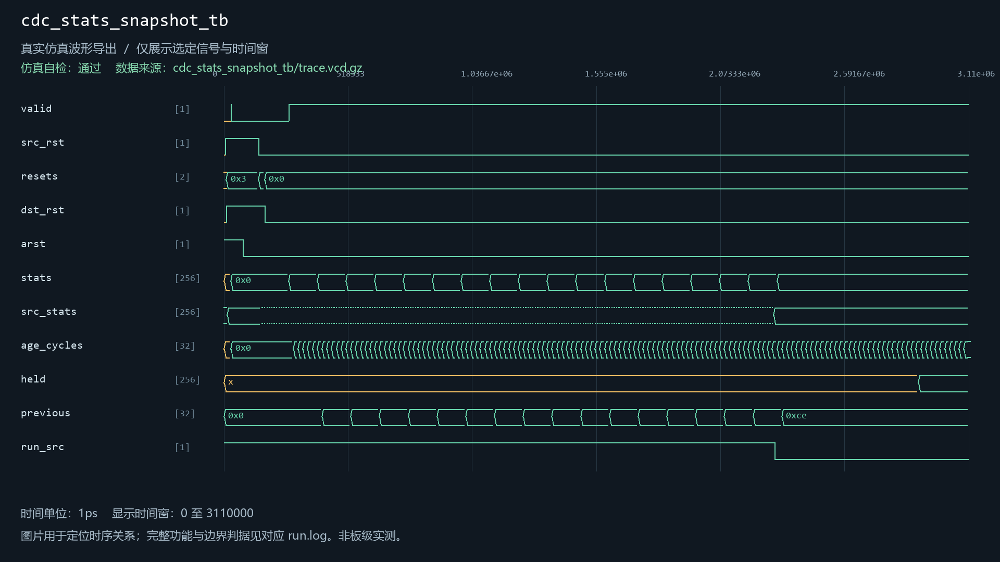
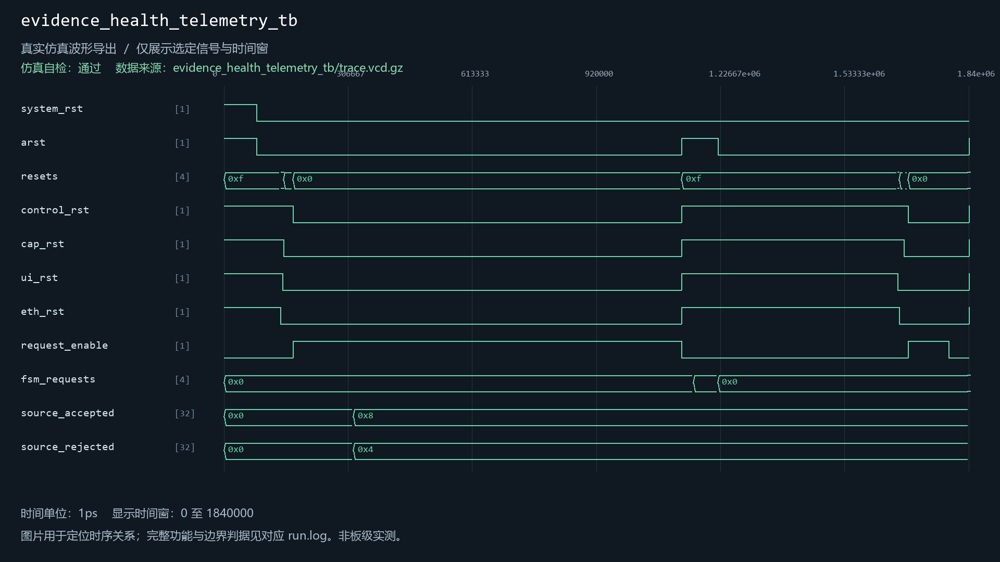
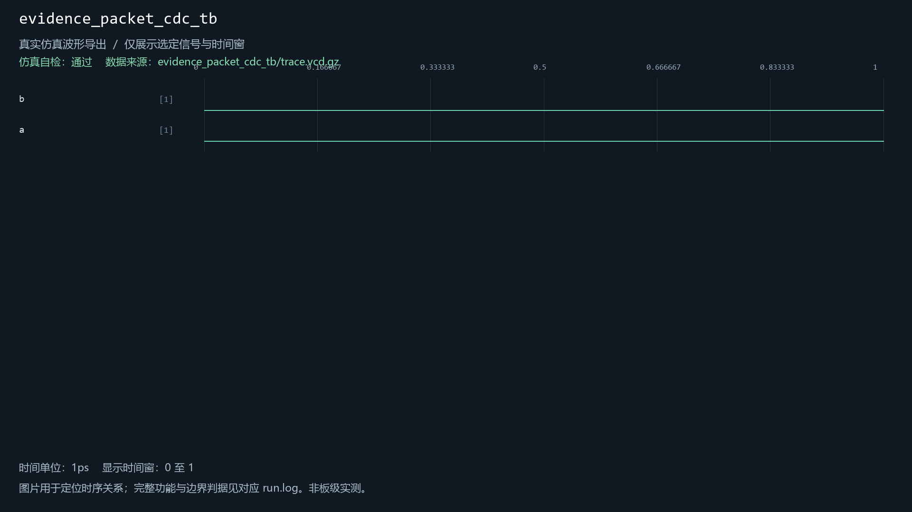
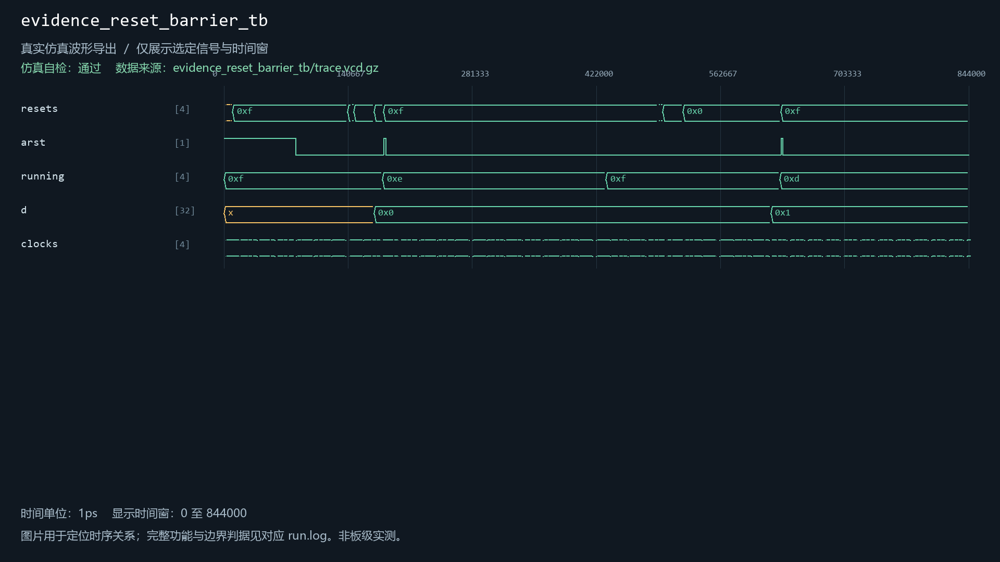
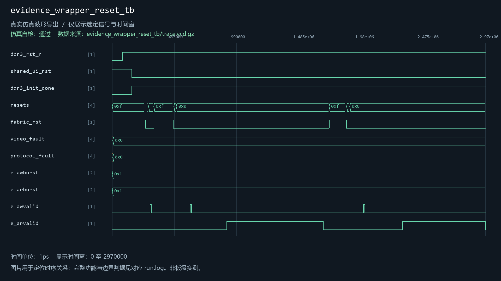
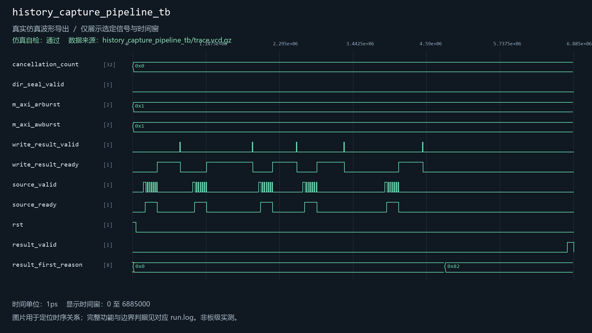
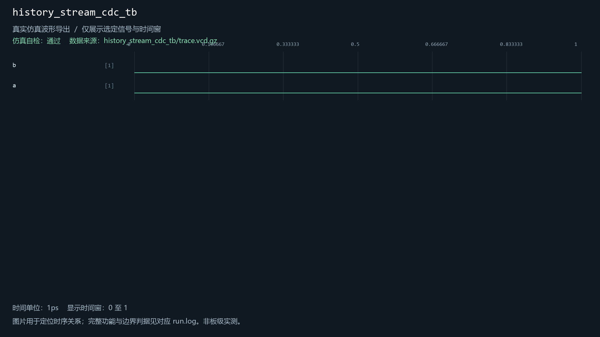
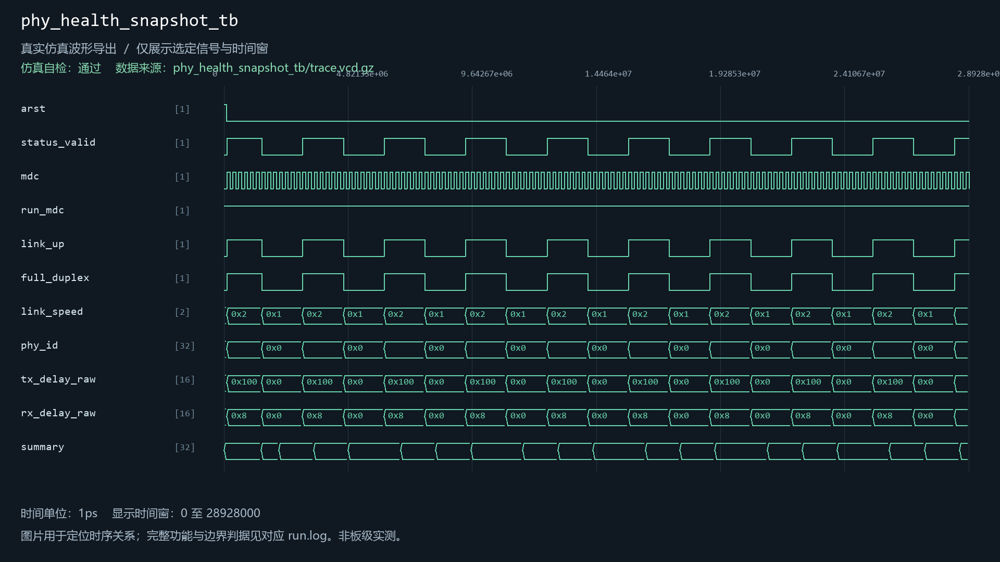
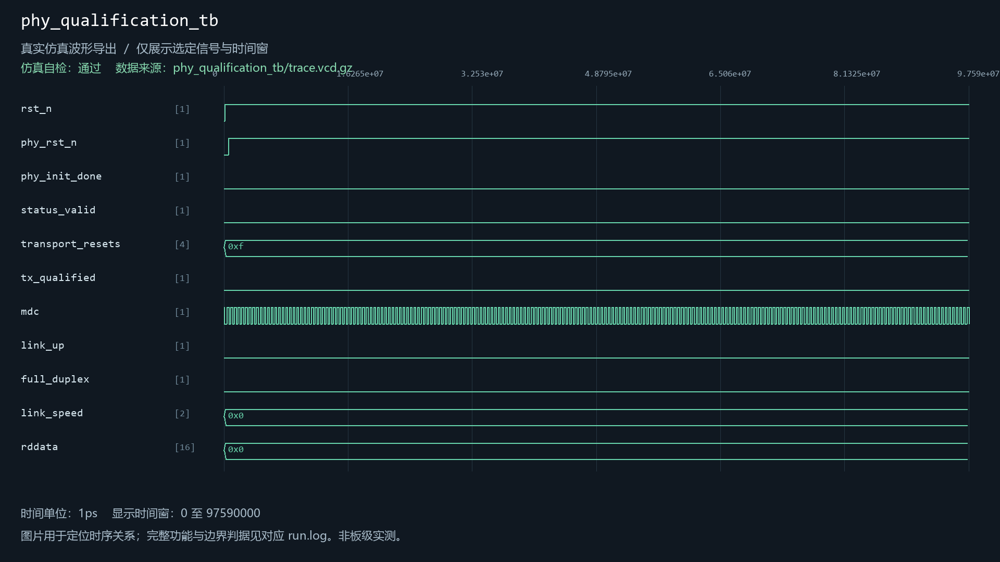
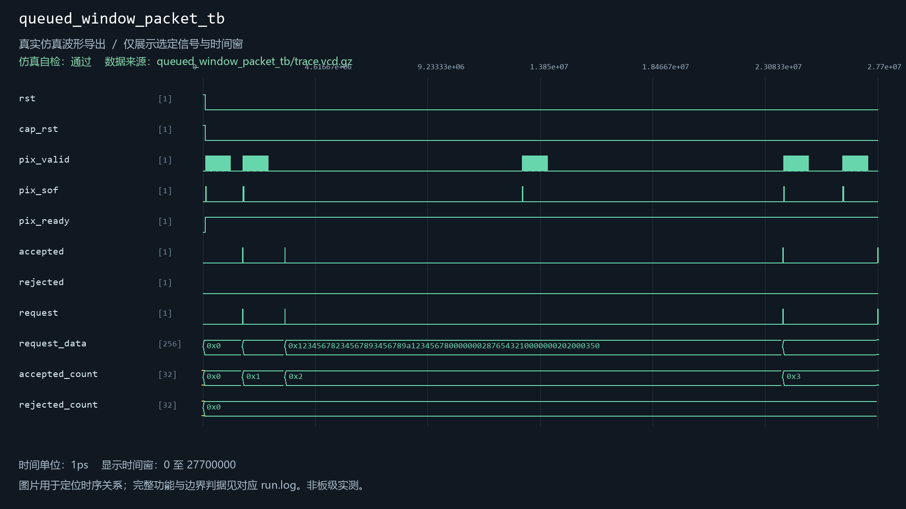

# evidence_reset_barrier

当前工程实例化：是。关联13个自检用例。

| 用例 | 仿真器 | 当前结果 | 运行日志 | 结果记录 |
| --- | --- | --- | --- | --- |
| camera_evidence_transport_tb | icarus | 通过 | [日志](../../sim/results/quality_current/camera_evidence_transport_tb/run.log) | [记录](../../sim/results/quality_current/camera_evidence_transport_tb/result.json) |
| cdc_stats_snapshot_tb | icarus | 通过 | [日志](../../sim/results/quality_current/cdc_stats_snapshot_tb/run.log) | [记录](../../sim/results/quality_current/cdc_stats_snapshot_tb/result.json) |
| evidence_health_telemetry_tb | xsim | 通过 | [日志](../../sim/results/quality_current/evidence_health_telemetry_tb/run.log) | [记录](../../sim/results/quality_current/evidence_health_telemetry_tb/result.json) |
| evidence_packet_cdc_tb | icarus | 通过 | [日志](../../sim/results/quality_current/evidence_packet_cdc_tb/run.log) | [记录](../../sim/results/quality_current/evidence_packet_cdc_tb/result.json) |
| evidence_reset_barrier_tb | icarus | 通过 | [日志](../../sim/results/quality_current/evidence_reset_barrier_tb/run.log) | [记录](../../sim/results/quality_current/evidence_reset_barrier_tb/result.json) |
| evidence_wrapper_reset_tb | xsim | 通过 | [日志](../../sim/results/quality_current/evidence_wrapper_reset_tb/run.log) | [记录](../../sim/results/quality_current/evidence_wrapper_reset_tb/result.json) |
| history_capture_client_tb | icarus | 通过 | [日志](../../sim/results/quality_current/history_capture_client_tb/run.log) | [记录](../../sim/results/quality_current/history_capture_client_tb/result.json) |
| history_capture_pipeline_tb | icarus | 通过 | [日志](../../sim/results/quality_current/history_capture_pipeline_tb/run.log) | [记录](../../sim/results/quality_current/history_capture_pipeline_tb/result.json) |
| history_stream_cdc_tb | icarus | 通过 | [日志](../../sim/results/quality_current/history_stream_cdc_tb/run.log) | [记录](../../sim/results/quality_current/history_stream_cdc_tb/result.json) |
| phy_health_snapshot_tb | xsim | 通过 | [日志](../../sim/results/quality_current/phy_health_snapshot_tb/run.log) | [记录](../../sim/results/quality_current/phy_health_snapshot_tb/result.json) |
| phy_qualification_tb | xsim | 通过 | [日志](../../sim/results/quality_current/phy_qualification_tb/run.log) | [记录](../../sim/results/quality_current/phy_qualification_tb/result.json) |
| queued_window_packet_tb | xsim | 通过 | [日志](../../sim/results/quality_current/queued_window_packet_tb/run.log) | [记录](../../sim/results/quality_current/queued_window_packet_tb/result.json) |
| video_memory_fabric_tb | xsim | 通过 | [日志](../../sim/results/quality_current/video_memory_fabric_tb/run.log) | [记录](../../sim/results/quality_current/video_memory_fabric_tb/result.json) |

单独重跑本模块关联用例（工程根目录）：

```powershell
python sim/run_module_tests.py --only camera_evidence_transport_tb cdc_stats_snapshot_tb evidence_health_telemetry_tb evidence_packet_cdc_tb evidence_reset_barrier_tb evidence_wrapper_reset_tb history_capture_client_tb history_capture_pipeline_tb history_stream_cdc_tb phy_health_snapshot_tb phy_qualification_tb queued_window_packet_tb video_memory_fabric_tb --vivado-bin "$env:EXAMGUARD_VIVADO_BIN" --iverilog-bin "$env:EXAMGUARD_IVERILOG_BIN"
```

先按[复原说明](../../build/reproduction.md)配置工具。每次生成新的结果目录。

## camera_evidence_transport_tb

用例源码：[camera_evidence_transport_tb.sv](../../sim/sources/ddr3_test/camera_evidence_transport_tb.sv), [axi_frame_slave_model.sv](../../sim/sources/ddr3_test/axi_frame_slave_model.sv)

历史VCD数据导出图（并非Vivado截图）：


## cdc_stats_snapshot_tb

用例源码：[cdc_stats_snapshot_tb.sv](../../sim/sources/health/cdc_stats_snapshot_tb.sv)

历史VCD数据导出图（并非Vivado截图）：



## evidence_health_telemetry_tb

用例源码：[evidence_health_telemetry_tb.sv](../../sim/sources/health/evidence_health_telemetry_tb.sv)

历史VCD数据导出图（并非Vivado截图）：



## evidence_packet_cdc_tb

用例源码：[evidence_packet_cdc_tb.sv](../../sim/sources/ddr3_test/evidence_packet_cdc_tb.sv)

历史VCD数据导出图（并非Vivado截图）：



## evidence_reset_barrier_tb

用例源码：[evidence_reset_barrier_tb.sv](../../sim/sources/event_identity/evidence_reset_barrier_tb.sv)

历史VCD数据导出图（并非Vivado截图）：



## evidence_wrapper_reset_tb

用例源码：[evidence_wrapper_reset_tb.sv](../../sim/test_repairs/evidence_wrapper_reset_tb/evidence_wrapper_reset_tb.sv), [axi_frame_slave_model.sv](../../sim/sources/ddr3_test/axi_frame_slave_model.sv), [mig_axi_reset_contract_model.sv](../../sim/test_repairs/evidence_wrapper_reset_tb/mig_axi_reset_contract_model.sv)

历史VCD数据导出图（并非Vivado截图）：



## history_capture_client_tb

用例源码：[history_capture_client_tb.sv](../../sim/sources/ddr3_test/history_capture_client_tb.sv), [axi_frame_slave_model.sv](../../sim/sources/ddr3_test/axi_frame_slave_model.sv)

历史VCD数据导出图（并非Vivado截图）：


## history_capture_pipeline_tb

用例源码：[history_capture_pipeline_tb.sv](../../sim/sources/ddr3_test/history_capture_pipeline_tb.sv), [axi_frame_slave_model.sv](../../sim/sources/ddr3_test/axi_frame_slave_model.sv)

历史VCD数据导出图（并非Vivado截图）：



## history_stream_cdc_tb

用例源码：[history_stream_cdc_tb.sv](../../sim/sources/ddr3_test/history_stream_cdc_tb.sv)

历史VCD数据导出图（并非Vivado截图）：



## phy_health_snapshot_tb

用例源码：[phy_health_snapshot_tb.sv](../../sim/sources/health/phy_health_snapshot_tb.sv)

历史VCD数据导出图（并非Vivado截图）：



## phy_qualification_tb

用例源码：[phy_qualification_tb.sv](../../sim/sources/host_link/phy_qualification_tb.sv), [rtl8211f_wire_model.sv](../../sim/sources/host_link/rtl8211f_wire_model.sv)

历史VCD数据导出图（并非Vivado截图）：



## queued_window_packet_tb

用例源码：[queued_window_packet_tb.sv](../../sim/sources/ddr3_test/queued_window_packet_tb.sv), [axi_frame_slave_model.sv](../../sim/sources/ddr3_test/axi_frame_slave_model.sv)

历史VCD数据导出图（并非Vivado截图）：



## video_memory_fabric_tb

用例源码：[video_memory_fabric_tb.sv](../../sim/sources/ddr3_test/video_memory_fabric_tb.sv), [axi_frame_slave_model.sv](../../sim/sources/ddr3_test/axi_frame_slave_model.sv)

历史VCD数据导出图（并非Vivado截图）：


