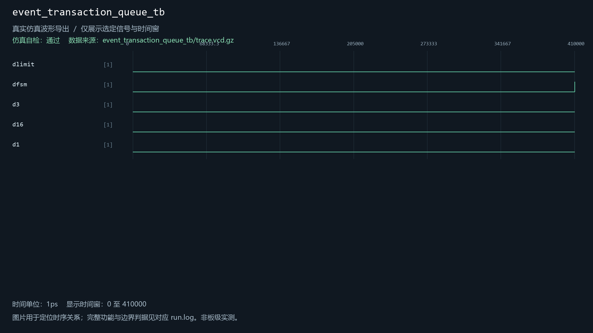
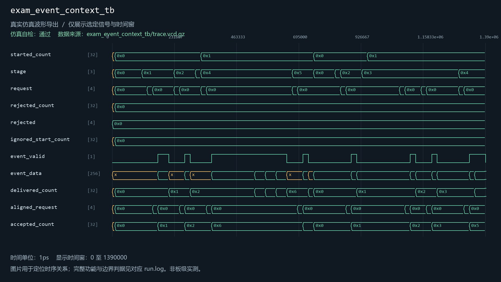
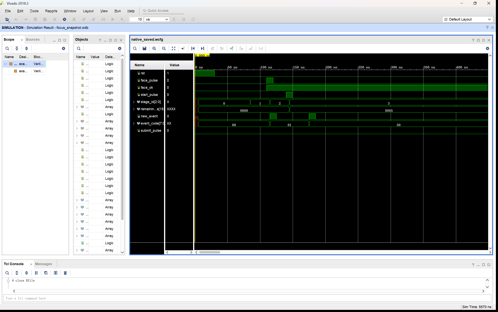
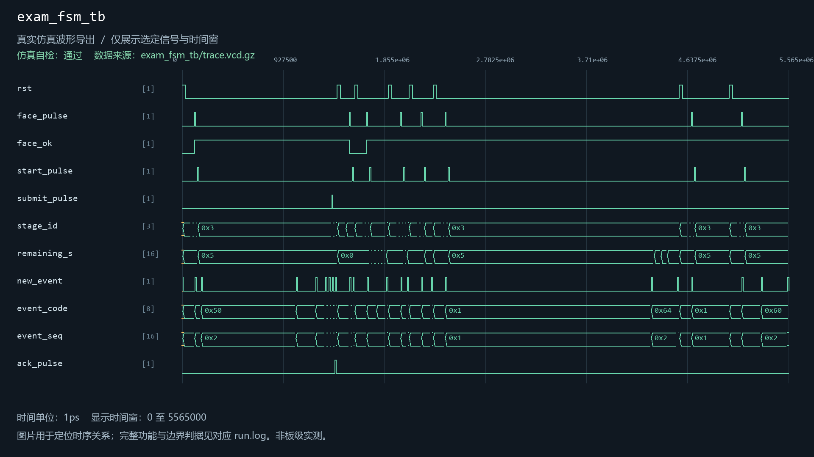
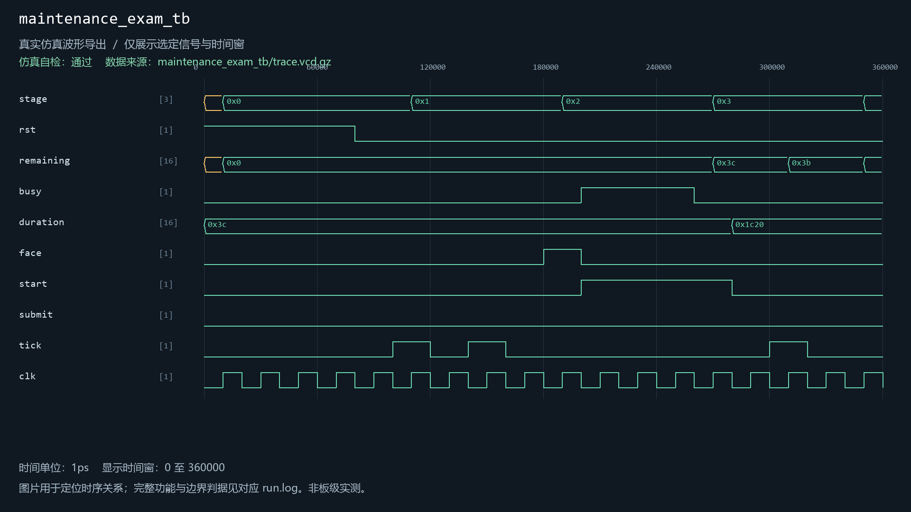
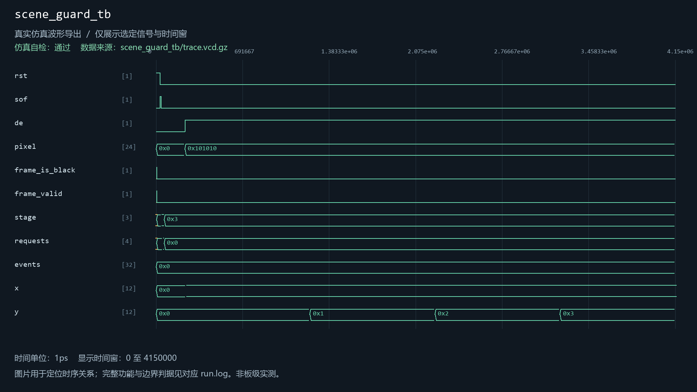
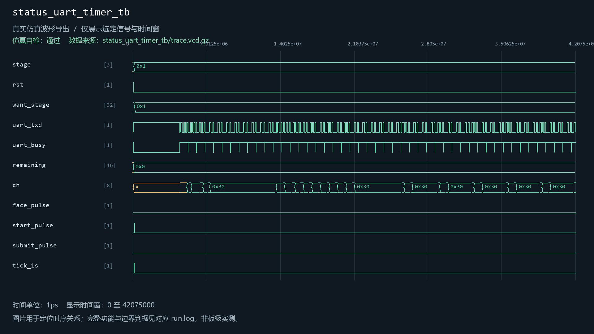
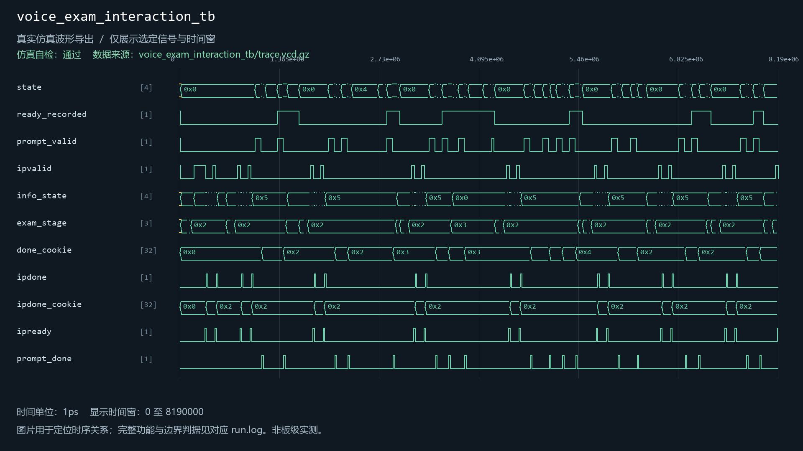
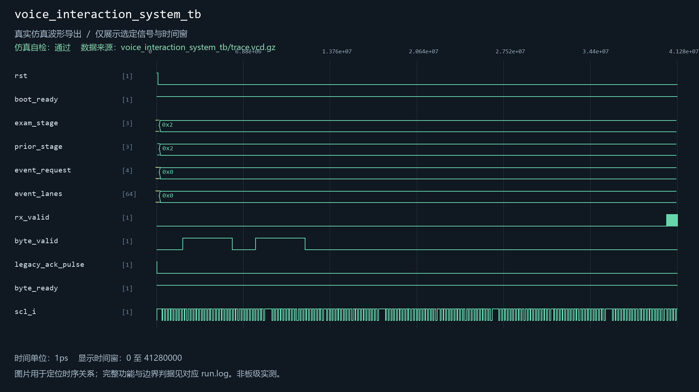

# exam_fsm

当前工程实例化：是。关联9个自检用例。

| 用例 | 仿真器 | 当前结果 | 运行日志 | 结果记录 |
| --- | --- | --- | --- | --- |
| camera_evidence_transport_tb | icarus | 通过 | [日志](../../sim/results/quality_current/camera_evidence_transport_tb/run.log) | [记录](../../sim/results/quality_current/camera_evidence_transport_tb/result.json) |
| event_transaction_queue_tb | icarus | 通过 | [日志](../../sim/results/quality_current/event_transaction_queue_tb/run.log) | [记录](../../sim/results/quality_current/event_transaction_queue_tb/result.json) |
| exam_event_context_tb | icarus | 通过 | [日志](../../sim/results/quality_current/exam_event_context_tb/run.log) | [记录](../../sim/results/quality_current/exam_event_context_tb/result.json) |
| exam_fsm_tb | icarus | 通过 | [日志](../../sim/results/quality_current/exam_fsm_tb/run.log) | [记录](../../sim/results/quality_current/exam_fsm_tb/result.json) |
| maintenance_exam_tb | icarus | 通过 | [日志](../../sim/results/quality_current/maintenance_exam_tb/run.log) | [记录](../../sim/results/quality_current/maintenance_exam_tb/result.json) |
| scene_guard_tb | xsim | 通过 | [日志](../../sim/results/quality_current/scene_guard_tb/run.log) | [记录](../../sim/results/quality_current/scene_guard_tb/result.json) |
| status_uart_timer_tb | icarus | 通过 | [日志](../../sim/results/quality_current/status_uart_timer_tb/run.log) | [记录](../../sim/results/quality_current/status_uart_timer_tb/result.json) |
| voice_exam_interaction_tb | icarus | 通过 | [日志](../../sim/results/quality_current/voice_exam_interaction_tb/run.log) | [记录](../../sim/results/quality_current/voice_exam_interaction_tb/result.json) |
| voice_interaction_system_tb | xsim | 通过 | [日志](../../sim/results/quality_current/voice_interaction_system_tb/run.log) | [记录](../../sim/results/quality_current/voice_interaction_system_tb/result.json) |

单独重跑本模块关联用例（工程根目录）：

```powershell
python sim/run_module_tests.py --only camera_evidence_transport_tb event_transaction_queue_tb exam_event_context_tb exam_fsm_tb maintenance_exam_tb scene_guard_tb status_uart_timer_tb voice_exam_interaction_tb voice_interaction_system_tb --vivado-bin "$env:EXAMGUARD_VIVADO_BIN" --iverilog-bin "$env:EXAMGUARD_IVERILOG_BIN"
```

先按[复原说明](../../build/reproduction.md)配置工具。每次生成新的结果目录。

## camera_evidence_transport_tb

用例源码：[camera_evidence_transport_tb.sv](../../sim/sources/ddr3_test/camera_evidence_transport_tb.sv), [axi_frame_slave_model.sv](../../sim/sources/ddr3_test/axi_frame_slave_model.sv)

历史VCD数据导出图（并非Vivado截图）：


## event_transaction_queue_tb

用例源码：[event_transaction_queue_tb.sv](../../sim/sources/event_transaction_queue/event_transaction_queue_tb.sv)

历史VCD数据导出图（并非Vivado截图）：



## exam_event_context_tb

用例源码：[exam_event_context_tb.sv](../../sim/sources/event_identity/exam_event_context_tb.sv)

历史VCD数据导出图（并非Vivado截图）：



## exam_fsm_tb

用例源码：[exam_fsm_tb.v](../../src/fpga/ov5640_ddr3_hdmi_vga.srcs/sources_1/exam_fsm/exam_fsm_tb.v)

Vivado原生波形（与所列用例及WDB对应）：



[原始WDB](../../sim/native_databases/exam_fsm_tb/focus_snapshot.wdb)

历史VCD数据导出图（并非Vivado截图）：



## maintenance_exam_tb

用例源码：[maintenance_exam_tb.sv](../../sim/sources/persistence/maintenance_exam_tb.sv)

历史VCD数据导出图（并非Vivado截图）：



## scene_guard_tb

用例源码：[scene_guard_tb.sv](../../sim/sources/vision_guard/scene_guard_tb.sv)

历史VCD数据导出图（并非Vivado截图）：



## status_uart_timer_tb

用例源码：[status_uart_timer_tb.sv](../../sim/sources/event_identity/status_uart_timer_tb.sv)

历史VCD数据导出图（并非Vivado截图）：



## voice_exam_interaction_tb

用例源码：[voice_exam_interaction_tb.sv](../../sim/sources/voice_interaction/voice_exam_interaction_tb.sv)

历史VCD数据导出图（并非Vivado截图）：



## voice_interaction_system_tb

用例源码：[voice_interaction_system_tb.sv](../../sim/sources/voice_interaction/voice_interaction_system_tb.sv), [wonderecho_wire_model.sv](../../sim/sources/voice_interaction/wonderecho_wire_model.sv)

历史VCD数据导出图（并非Vivado截图）：


