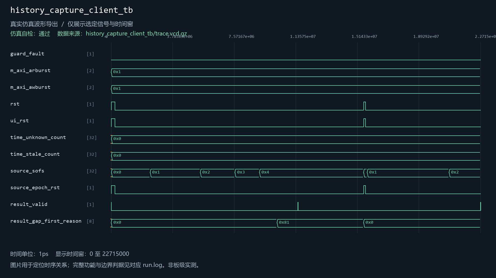
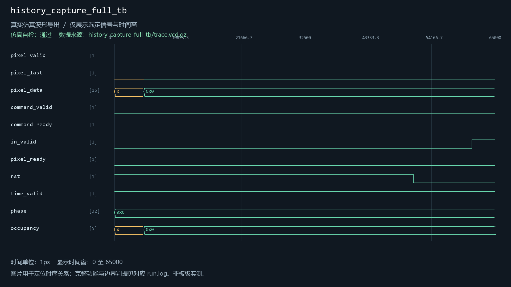
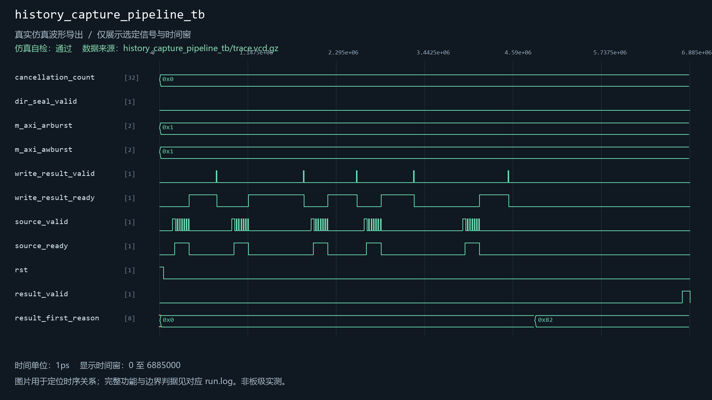
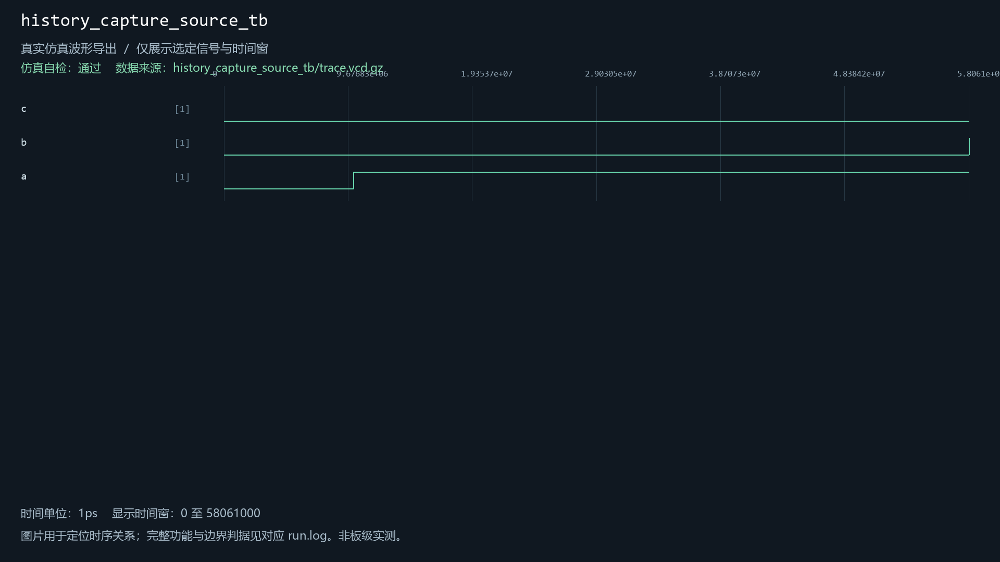
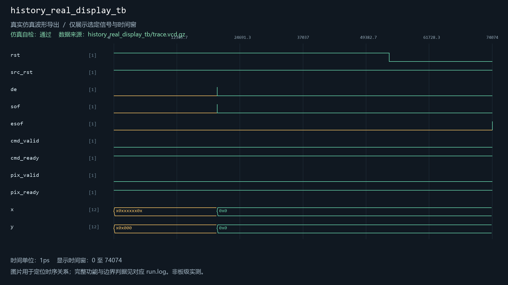
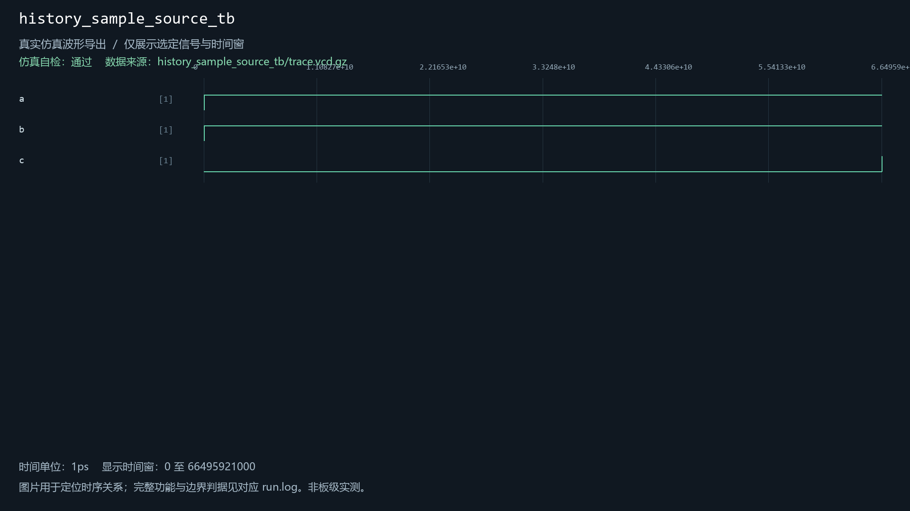

# history_capture_source

当前工程实例化：是。关联6个自检用例。

| 用例 | 仿真器 | 当前结果 | 运行日志 | 结果记录 |
| --- | --- | --- | --- | --- |
| history_capture_client_tb | icarus | 通过 | [日志](../../sim/results/quality_current/history_capture_client_tb/run.log) | [记录](../../sim/results/quality_current/history_capture_client_tb/result.json) |
| history_capture_full_tb | icarus | 通过 | [日志](../../sim/results/quality_current/history_capture_full_tb/run.log) | [记录](../../sim/results/quality_current/history_capture_full_tb/result.json) |
| history_capture_pipeline_tb | icarus | 通过 | [日志](../../sim/results/quality_current/history_capture_pipeline_tb/run.log) | [记录](../../sim/results/quality_current/history_capture_pipeline_tb/result.json) |
| history_capture_source_tb | icarus | 通过 | [日志](../../sim/results/quality_current/history_capture_source_tb/run.log) | [记录](../../sim/results/quality_current/history_capture_source_tb/result.json) |
| history_real_display_tb | xsim | 通过 | [日志](../../sim/results/quality_current/history_real_display_tb/run.log) | [记录](../../sim/results/quality_current/history_real_display_tb/result.json) |
| history_sample_source_tb | xsim | 通过 | [日志](../../sim/results/quality_current/history_sample_source_tb/run.log) | [记录](../../sim/results/quality_current/history_sample_source_tb/result.json) |

单独重跑本模块关联用例（工程根目录）：

```powershell
python sim/run_module_tests.py --only history_capture_client_tb history_capture_full_tb history_capture_pipeline_tb history_capture_source_tb history_real_display_tb history_sample_source_tb --vivado-bin "$env:EXAMGUARD_VIVADO_BIN" --iverilog-bin "$env:EXAMGUARD_IVERILOG_BIN"
```

先按[复原说明](../../build/reproduction.md)配置工具。每次生成新的结果目录。

## history_capture_client_tb

用例源码：[history_capture_client_tb.sv](../../sim/sources/ddr3_test/history_capture_client_tb.sv), [axi_frame_slave_model.sv](../../sim/sources/ddr3_test/axi_frame_slave_model.sv)

历史VCD数据导出图（并非Vivado截图）：



## history_capture_full_tb

用例源码：[history_capture_full_tb.sv](../../sim/sources/ddr3_test/history_capture_full_tb.sv)

历史VCD数据导出图（并非Vivado截图）：



## history_capture_pipeline_tb

用例源码：[history_capture_pipeline_tb.sv](../../sim/sources/ddr3_test/history_capture_pipeline_tb.sv), [axi_frame_slave_model.sv](../../sim/sources/ddr3_test/axi_frame_slave_model.sv)

历史VCD数据导出图（并非Vivado截图）：



## history_capture_source_tb

用例源码：[history_capture_source_tb.sv](../../sim/sources/ddr3_test/history_capture_source_tb.sv)

历史VCD数据导出图（并非Vivado截图）：



## history_real_display_tb

用例源码：[history_real_display_tb.sv](../../sim/sources/ddr3_test/history_real_display_tb.sv)

历史VCD数据导出图（并非Vivado截图）：



## history_sample_source_tb

用例源码：[history_sample_source_tb.sv](../../sim/sources/ddr3_test/history_sample_source_tb.sv)

历史VCD数据导出图（并非Vivado截图）：


