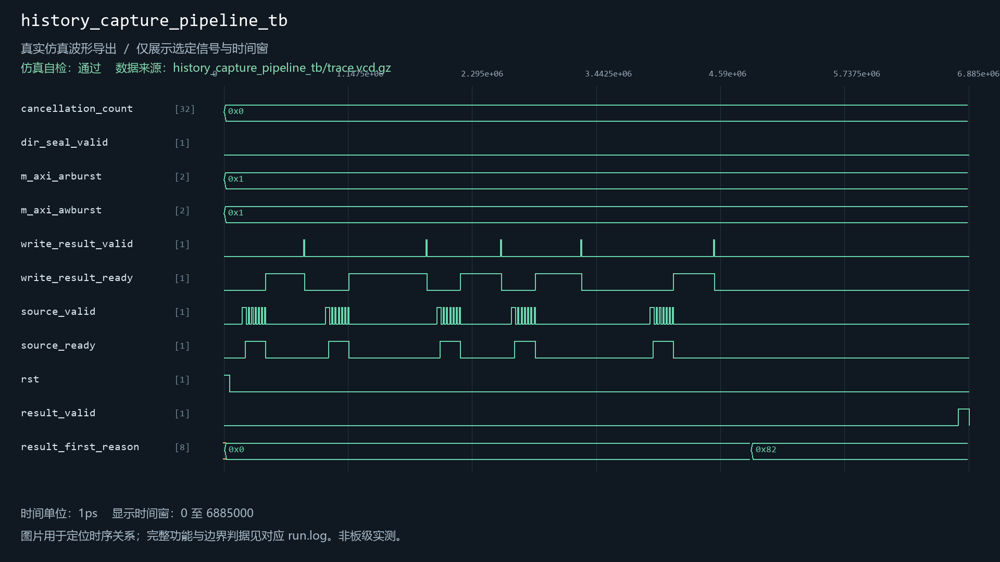
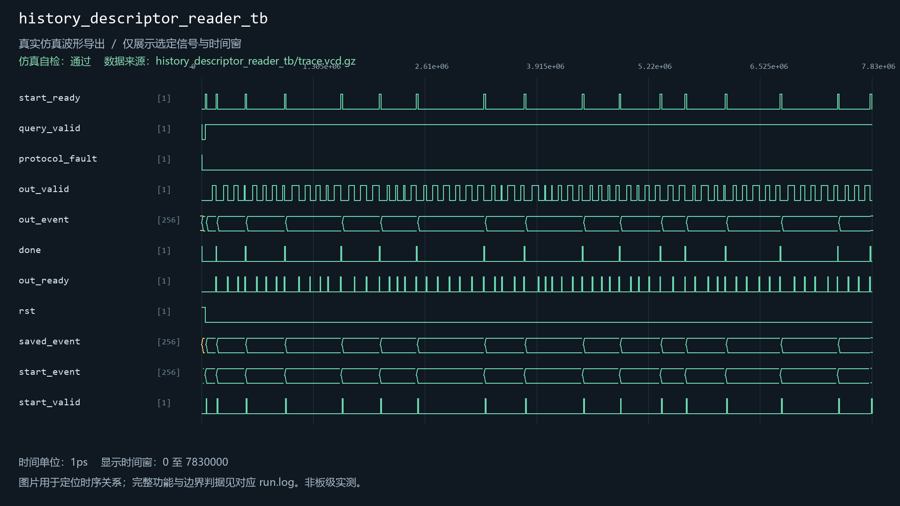
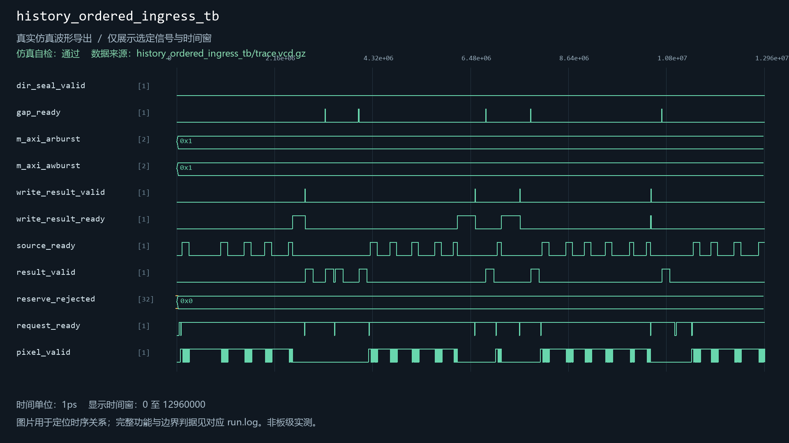
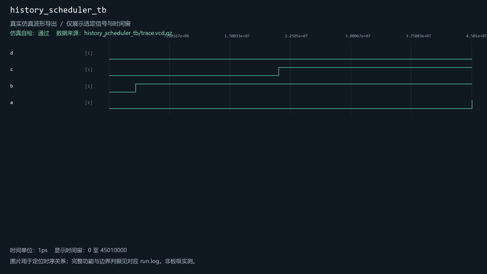
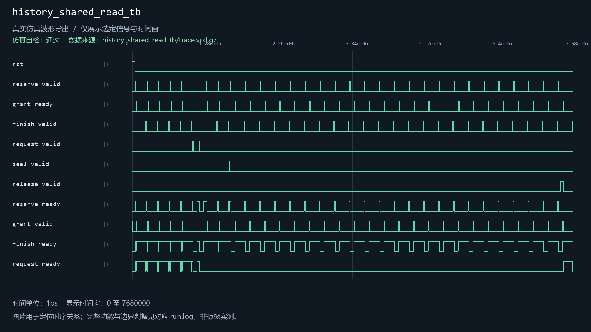
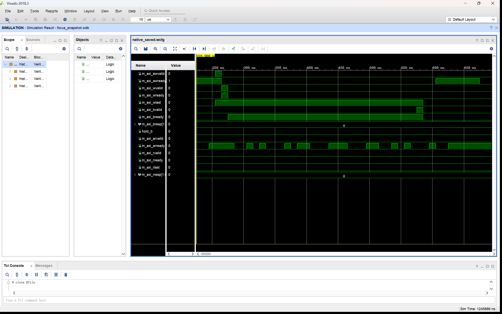
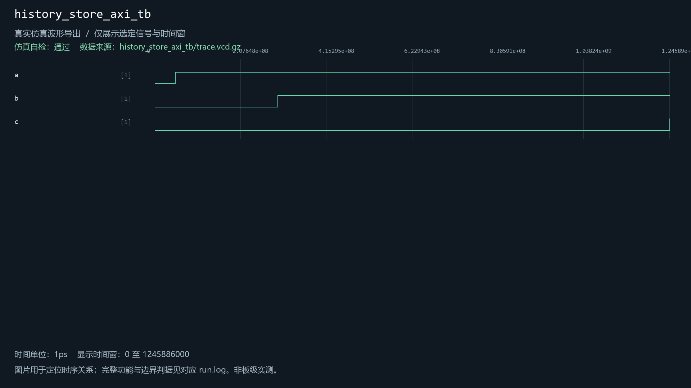
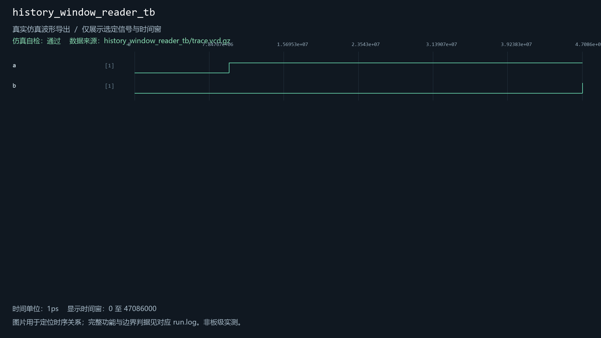

# history_descriptor_reader

当前工程实例化：是。关联8个自检用例。

| 用例 | 仿真器 | 当前结果 | 运行日志 | 结果记录 |
| --- | --- | --- | --- | --- |
| history_capture_client_tb | icarus | 通过 | [日志](../../sim/results/quality_current/history_capture_client_tb/run.log) | [记录](../../sim/results/quality_current/history_capture_client_tb/result.json) |
| history_capture_pipeline_tb | icarus | 通过 | [日志](../../sim/results/quality_current/history_capture_pipeline_tb/run.log) | [记录](../../sim/results/quality_current/history_capture_pipeline_tb/result.json) |
| history_descriptor_reader_tb | icarus | 通过 | [日志](../../sim/results/quality_current/history_descriptor_reader_tb/run.log) | [记录](../../sim/results/quality_current/history_descriptor_reader_tb/result.json) |
| history_ordered_ingress_tb | icarus | 通过 | [日志](../../sim/results/quality_current/history_ordered_ingress_tb/run.log) | [记录](../../sim/results/quality_current/history_ordered_ingress_tb/result.json) |
| history_scheduler_tb | icarus | 通过 | [日志](../../sim/results/quality_current/history_scheduler_tb/run.log) | [记录](../../sim/results/quality_current/history_scheduler_tb/result.json) |
| history_shared_read_tb | xsim | 通过 | [日志](../../sim/results/quality_current/history_shared_read_tb/run.log) | [记录](../../sim/results/quality_current/history_shared_read_tb/result.json) |
| history_store_axi_tb | xsim | 通过 | [日志](../../sim/results/quality_current/history_store_axi_tb/run.log) | [记录](../../sim/results/quality_current/history_store_axi_tb/result.json) |
| history_window_reader_tb | xsim | 通过 | [日志](../../sim/results/quality_current/history_window_reader_tb/run.log) | [记录](../../sim/results/quality_current/history_window_reader_tb/result.json) |

单独重跑本模块关联用例（工程根目录）：

```powershell
python sim/run_module_tests.py --only history_capture_client_tb history_capture_pipeline_tb history_descriptor_reader_tb history_ordered_ingress_tb history_scheduler_tb history_shared_read_tb history_store_axi_tb history_window_reader_tb --vivado-bin "$env:EXAMGUARD_VIVADO_BIN" --iverilog-bin "$env:EXAMGUARD_IVERILOG_BIN"
```

先按[复原说明](../../build/reproduction.md)配置工具。每次生成新的结果目录。

## history_capture_client_tb

用例源码：[history_capture_client_tb.sv](../../sim/sources/ddr3_test/history_capture_client_tb.sv), [axi_frame_slave_model.sv](../../sim/sources/ddr3_test/axi_frame_slave_model.sv)

VCD仿真波形（来源批次见索引）：


## history_capture_pipeline_tb

用例源码：[history_capture_pipeline_tb.sv](../../sim/sources/ddr3_test/history_capture_pipeline_tb.sv), [axi_frame_slave_model.sv](../../sim/sources/ddr3_test/axi_frame_slave_model.sv)

VCD仿真波形（来源批次见索引）：



## history_descriptor_reader_tb

用例源码：[history_descriptor_reader_tb.sv](../../sim/sources/ddr3_test/history_descriptor_reader_tb.sv)

VCD仿真波形（来源批次见索引）：



## history_ordered_ingress_tb

用例源码：[history_ordered_ingress_tb.sv](../../sim/sources/ddr3_test/history_ordered_ingress_tb.sv), [axi_frame_slave_model.sv](../../sim/sources/ddr3_test/axi_frame_slave_model.sv)

VCD仿真波形（来源批次见索引）：



## history_scheduler_tb

用例源码：[history_scheduler_tb.sv](../../sim/sources/ddr3_test/history_scheduler_tb.sv), [axi_frame_slave_model.sv](../../sim/sources/ddr3_test/axi_frame_slave_model.sv)

VCD仿真波形（来源批次见索引）：



## history_shared_read_tb

用例源码：[history_shared_read_tb.sv](../../sim/test_repairs/history_shared_read_tb/history_shared_read_tb.sv), [axi_frame_slave_model.sv](../../sim/sources/ddr3_test/axi_frame_slave_model.sv)

VCD仿真波形（来源批次见索引）：



## history_store_axi_tb

用例源码：[history_store_axi_tb.sv](../../sim/sources/ddr3_test/history_store_axi_tb.sv), [axi_frame_slave_model.sv](../../sim/sources/ddr3_test/axi_frame_slave_model.sv)

Vivado原生波形（与所列用例及WDB对应）：



[原始WDB](../../sim/native_databases/history_store_axi_tb/focus_snapshot.wdb)

VCD仿真波形（来源批次见索引）：



## history_window_reader_tb

用例源码：[history_window_reader_tb.sv](../../sim/test_repairs/history_window_reader_tb/history_window_reader_tb.sv), [axi_frame_slave_model.sv](../../sim/sources/ddr3_test/axi_frame_slave_model.sv)

VCD仿真波形（来源批次见索引）：


