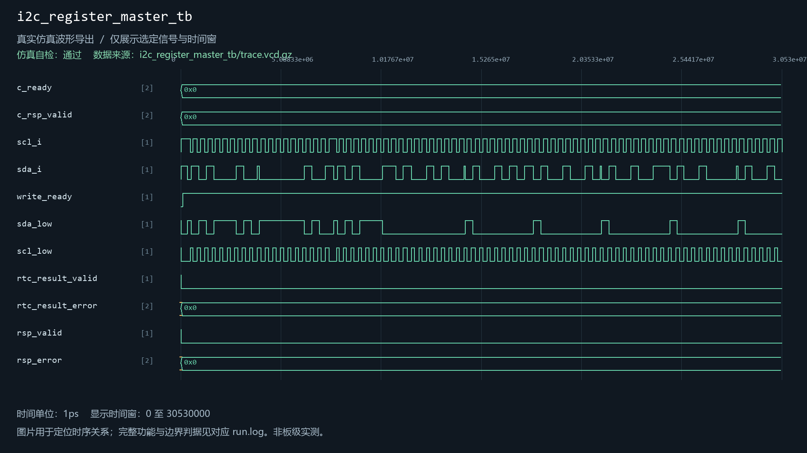
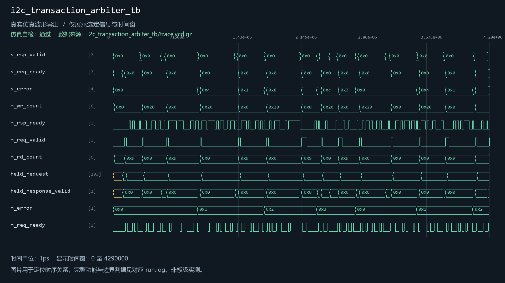
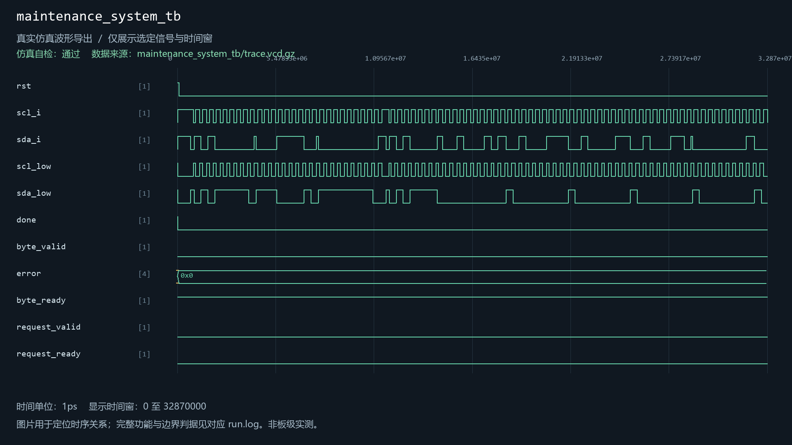
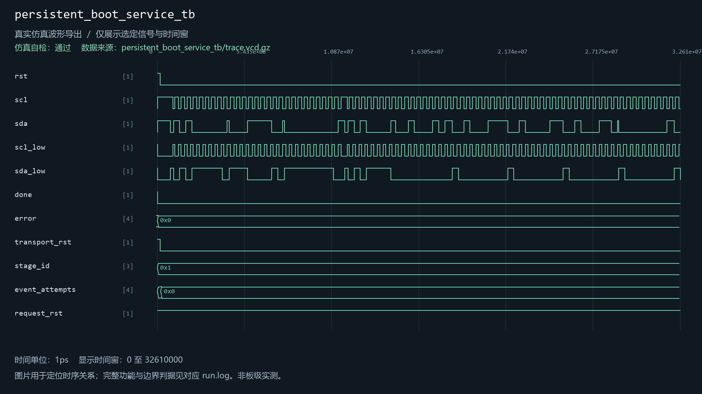
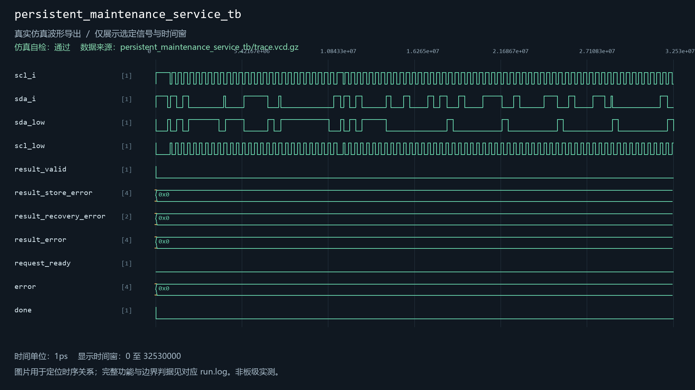

# i2c_transaction_arbiter

当前工程实例化：是。关联5个自检用例。

| 用例 | 仿真器 | 当前结果 | 运行日志 | 结果记录 |
| --- | --- | --- | --- | --- |
| i2c_register_master_tb | icarus | 通过 | [日志](../../sim/results/quality_current/i2c_register_master_tb/run.log) | [记录](../../sim/results/quality_current/i2c_register_master_tb/result.json) |
| i2c_transaction_arbiter_tb | icarus | 通过 | [日志](../../sim/results/quality_current/i2c_transaction_arbiter_tb/run.log) | [记录](../../sim/results/quality_current/i2c_transaction_arbiter_tb/result.json) |
| maintenance_system_tb | xsim | 通过 | [日志](../../sim/results/quality_current/maintenance_system_tb/run.log) | [记录](../../sim/results/quality_current/maintenance_system_tb/result.json) |
| persistent_boot_service_tb | xsim | 通过 | [日志](../../sim/results/quality_current/persistent_boot_service_tb/run.log) | [记录](../../sim/results/quality_current/persistent_boot_service_tb/result.json) |
| persistent_maintenance_service_tb | icarus | 通过 | [日志](../../sim/results/quality_current/persistent_maintenance_service_tb/run.log) | [记录](../../sim/results/quality_current/persistent_maintenance_service_tb/result.json) |

单独重跑本模块关联用例（工程根目录）：

```powershell
python sim/run_module_tests.py --only i2c_register_master_tb i2c_transaction_arbiter_tb maintenance_system_tb persistent_boot_service_tb persistent_maintenance_service_tb --vivado-bin "$env:EXAMGUARD_VIVADO_BIN" --iverilog-bin "$env:EXAMGUARD_IVERILOG_BIN"
```

先按[复原说明](../../build/reproduction.md)配置工具。每次生成新的结果目录。

## i2c_register_master_tb

用例源码：[i2c_register_master_tb.sv](../../sim/sources/persistence/i2c_register_master_tb.sv), [persistence_inventory_probe.sv](../../sim/sources/persistence/persistence_inventory_probe.sv)

VCD仿真波形（来源批次见索引）：



## i2c_transaction_arbiter_tb

用例源码：[i2c_transaction_arbiter_tb.sv](../../sim/sources/persistence/i2c_transaction_arbiter_tb.sv)

VCD仿真波形（来源批次见索引）：



## maintenance_system_tb

用例源码：[maintenance_system_tb.sv](../../sim/test_repairs/maintenance_system_tb/maintenance_system_tb.sv)

VCD仿真波形（来源批次见索引）：



## persistent_boot_service_tb

用例源码：[persistent_boot_service_tb.sv](../../sim/sources/persistence/persistent_boot_service_tb.sv)

VCD仿真波形（来源批次见索引）：



## persistent_maintenance_service_tb

用例源码：[persistent_maintenance_service_tb.sv](../../sim/sources/persistence/persistent_maintenance_service_tb.sv)

VCD仿真波形（来源批次见索引）：


