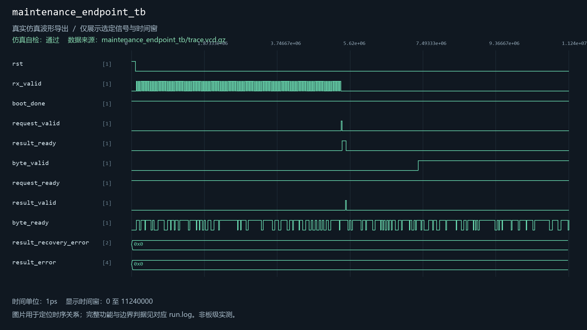
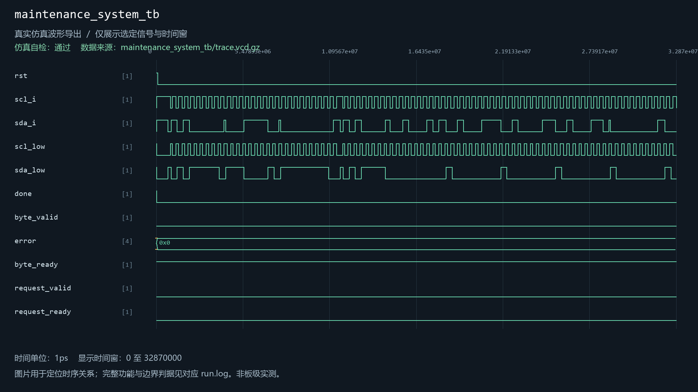

# maintenance_endpoint

当前工程实例化：是。关联2个自检用例。

| 用例 | 仿真器 | 当前结果 | 运行日志 | 结果记录 |
| --- | --- | --- | --- | --- |
| maintenance_endpoint_tb | xsim | 通过 | [日志](../../sim/results/quality_current/maintenance_endpoint_tb/run.log) | [记录](../../sim/results/quality_current/maintenance_endpoint_tb/result.json) |
| maintenance_system_tb | xsim | 通过 | [日志](../../sim/results/quality_current/maintenance_system_tb/run.log) | [记录](../../sim/results/quality_current/maintenance_system_tb/result.json) |

单独重跑本模块关联用例（工程根目录）：

```powershell
python sim/run_module_tests.py --only maintenance_endpoint_tb maintenance_system_tb --vivado-bin "$env:EXAMGUARD_VIVADO_BIN" --iverilog-bin "$env:EXAMGUARD_IVERILOG_BIN"
```

先按[复原说明](../../build/reproduction.md)配置工具。每次生成新的结果目录。

## maintenance_endpoint_tb

用例源码：[maintenance_endpoint_tb.sv](../../sim/test_repairs/maintenance_endpoint_tb/maintenance_endpoint_tb.sv)

VCD仿真波形（来源批次见索引）：



## maintenance_system_tb

用例源码：[maintenance_system_tb.sv](../../sim/test_repairs/maintenance_system_tb/maintenance_system_tb.sv)

VCD仿真波形（来源批次见索引）：


