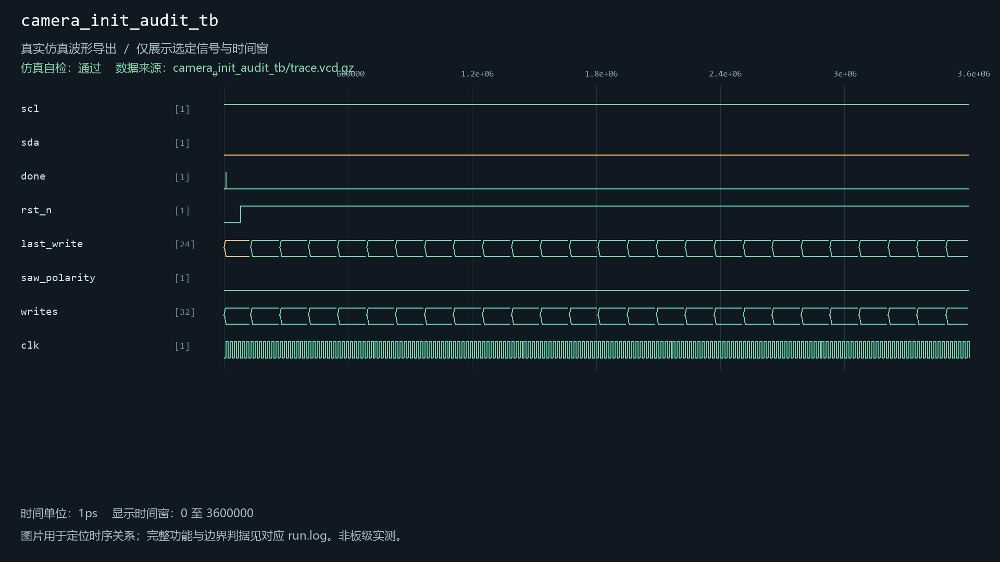
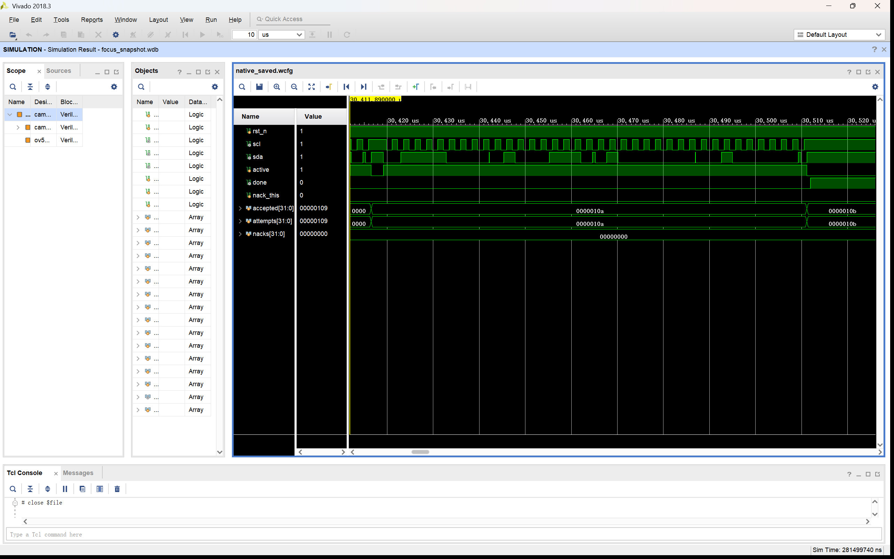
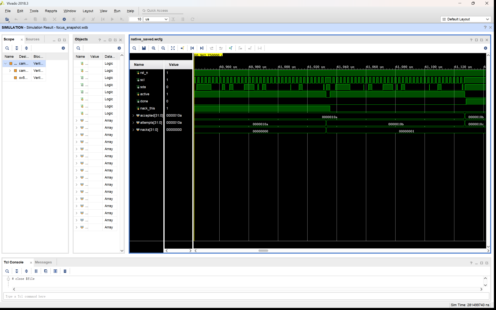
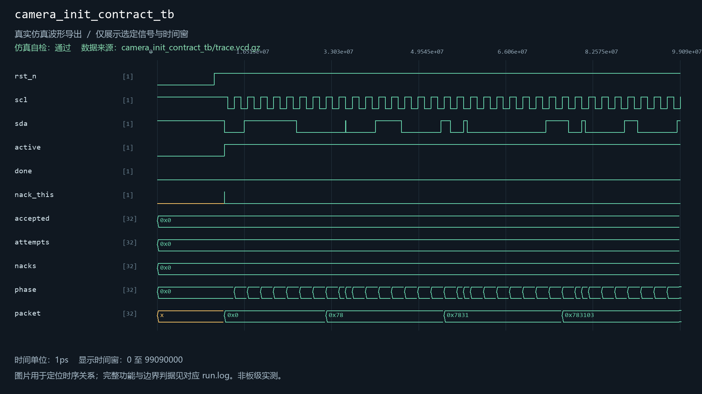

# ov7725_init_table_rgb

当前工程实例化：否。关联2个自检用例。

| 用例 | 仿真器 | 当前结果 | 运行日志 | 结果记录 |
| --- | --- | --- | --- | --- |
| camera_init_audit_tb | icarus | 通过 | [日志](../../sim/results/quality_current/camera_init_audit_tb/run.log) | [记录](../../sim/results/quality_current/camera_init_audit_tb/result.json) |
| camera_init_contract_tb | xsim | 通过 | [日志](../../sim/results/quality_current/camera_init_contract_tb/run.log) | [记录](../../sim/results/quality_current/camera_init_contract_tb/result.json) |

单独重跑本模块关联用例（工程根目录）：

```powershell
python sim/run_module_tests.py --only camera_init_audit_tb camera_init_contract_tb --vivado-bin "$env:EXAMGUARD_VIVADO_BIN" --iverilog-bin "$env:EXAMGUARD_IVERILOG_BIN"
```

先按[复原说明](../../build/reproduction.md)配置工具。每次生成新的结果目录。

## camera_init_audit_tb

用例源码：[camera_init_audit_tb.sv](../../sim/sources/ddr3_test/camera_init_audit_tb.sv)

VCD仿真波形（来源批次见索引）：



## camera_init_contract_tb

用例源码：[camera_init_contract_tb.sv](../../sim/sources/ddr3_test/camera_init_contract_tb.sv)

Vivado原生波形（与所列用例及WDB对应）：



[原始WDB](../../sim/native_databases/camera_init_contract_tb/focus_snapshot.wdb)

Vivado原生波形（与所列用例及WDB对应）：



[原始WDB](../../sim/native_databases/camera_init_contract_tb/focus_snapshot.wdb)

VCD仿真波形（来源批次见索引）：


