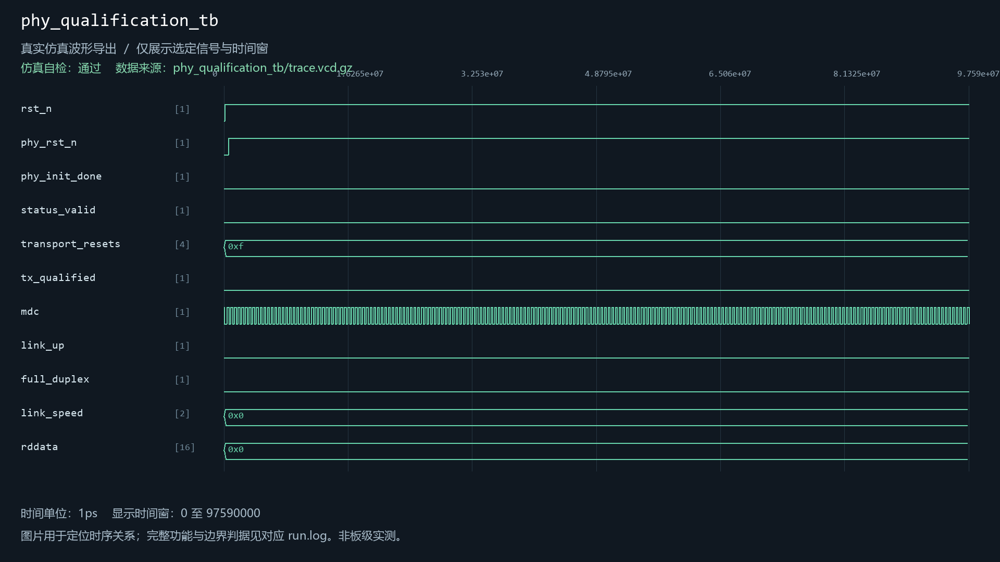

# phy_reg_config

当前工程实例化：是。关联1个自检用例。

| 用例 | 仿真器 | 当前结果 | 运行日志 | 结果记录 |
| --- | --- | --- | --- | --- |
| phy_qualification_tb | xsim | 通过 | [日志](../../sim/results/quality_current/phy_qualification_tb/run.log) | [记录](../../sim/results/quality_current/phy_qualification_tb/result.json) |

单独重跑本模块关联用例（工程根目录）：

```powershell
python sim/run_module_tests.py --only phy_qualification_tb --vivado-bin "$env:EXAMGUARD_VIVADO_BIN" --iverilog-bin "$env:EXAMGUARD_IVERILOG_BIN"
```

先按[复原说明](../../build/reproduction.md)配置工具。每次生成新的结果目录。

## phy_qualification_tb

用例源码：[phy_qualification_tb.sv](../../sim/sources/host_link/phy_qualification_tb.sv), [rtl8211f_wire_model.sv](../../sim/sources/host_link/rtl8211f_wire_model.sv)

历史VCD数据导出图（并非Vivado截图）：


