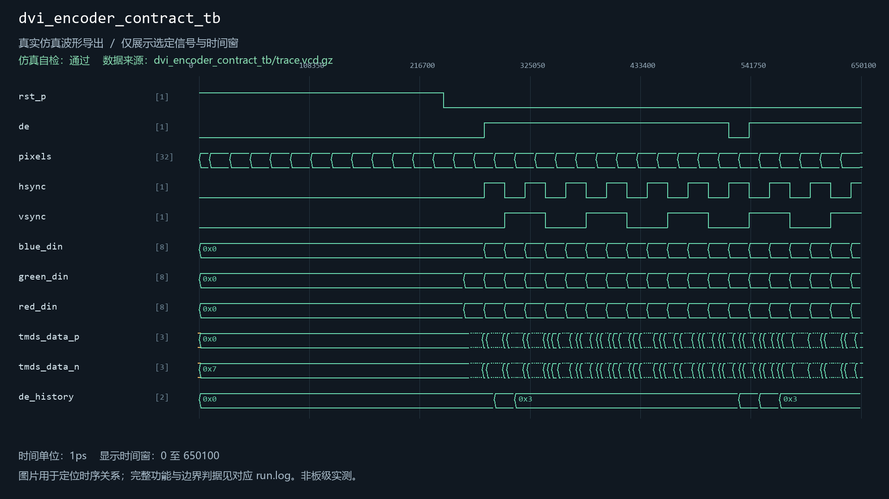
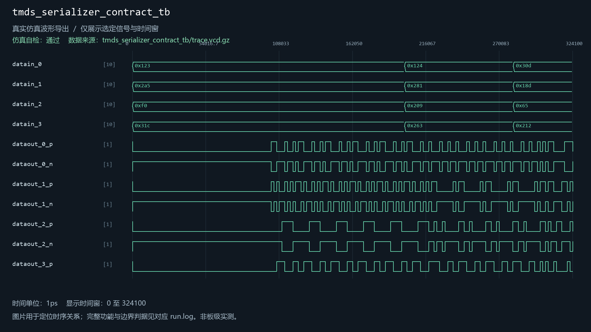

# serdes_4b_10to1

当前工程实例化：是。关联2个自检用例。

| 用例 | 仿真器 | 当前结果 | 运行日志 | 结果记录 |
| --- | --- | --- | --- | --- |
| dvi_encoder_contract_tb | xsim | 通过 | [日志](../../sim/results/quality_current/dvi_encoder_contract_tb/run.log) | [记录](../../sim/results/quality_current/dvi_encoder_contract_tb/result.json) |
| tmds_serializer_contract_tb | xsim | 通过 | [日志](../../sim/results/quality_current/tmds_serializer_contract_tb/run.log) | [记录](../../sim/results/quality_current/tmds_serializer_contract_tb/result.json) |

单独重跑本模块关联用例（工程根目录）：

```powershell
python sim/run_module_tests.py --only dvi_encoder_contract_tb tmds_serializer_contract_tb --vivado-bin "$env:EXAMGUARD_VIVADO_BIN" --iverilog-bin "$env:EXAMGUARD_IVERILOG_BIN"
```

先按[复原说明](../../build/reproduction.md)配置工具。每次生成新的结果目录。

## dvi_encoder_contract_tb

用例源码：[dvi_encoder_contract_tb.sv](../../sim/sources/verification_20261031/dvi_encoder_contract_tb.sv)

历史VCD数据导出图（并非Vivado截图）：



## tmds_serializer_contract_tb

用例源码：[tmds_serializer_contract_tb.sv](../../sim/sources/verification_20261031/tmds_serializer_contract_tb.sv)

历史VCD数据导出图（并非Vivado截图）：


