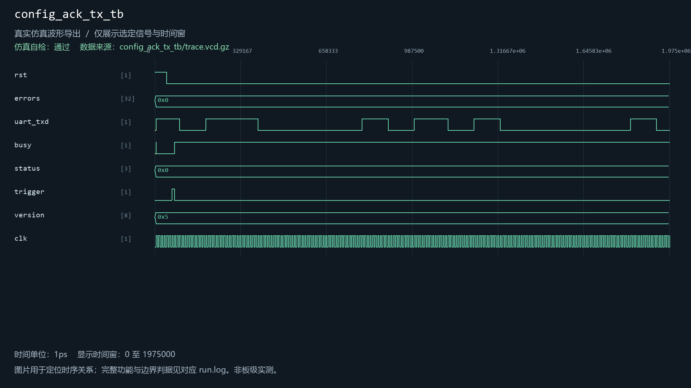
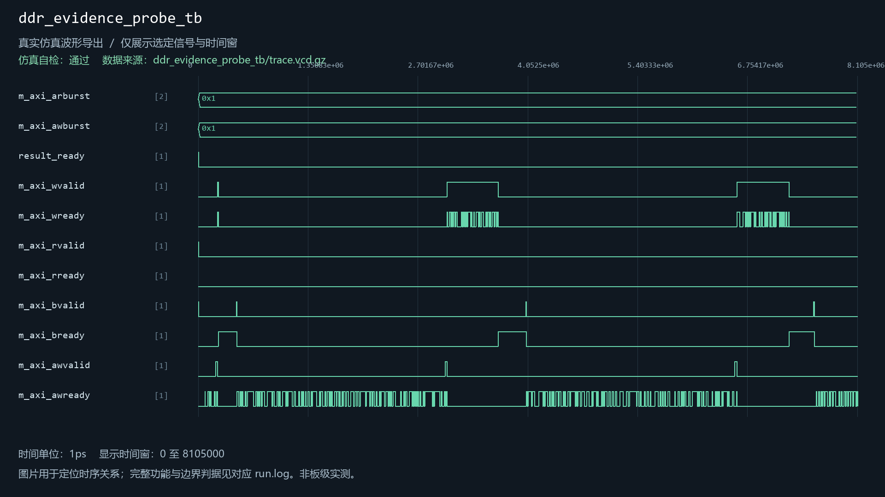
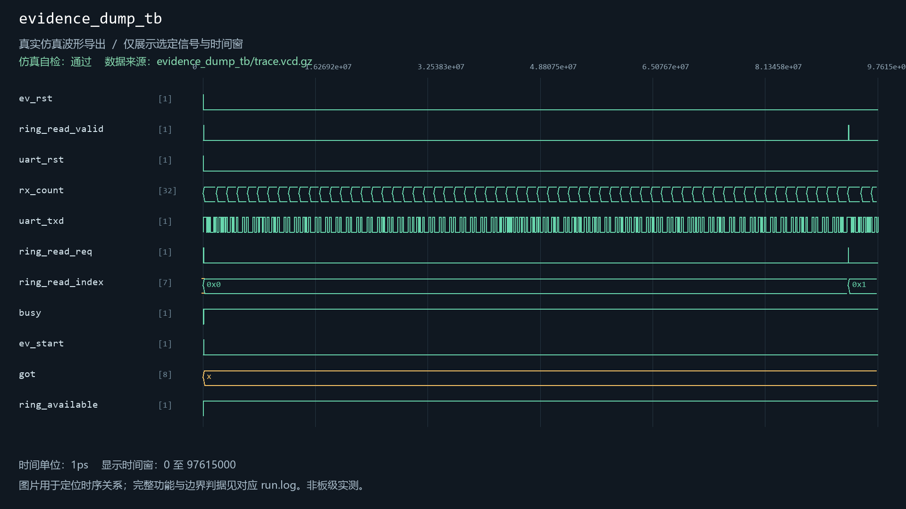
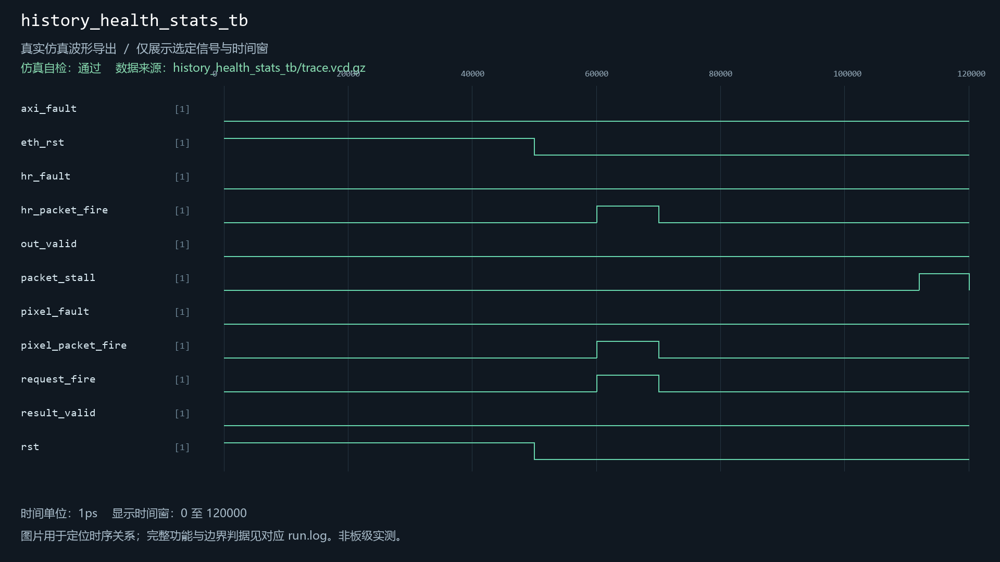
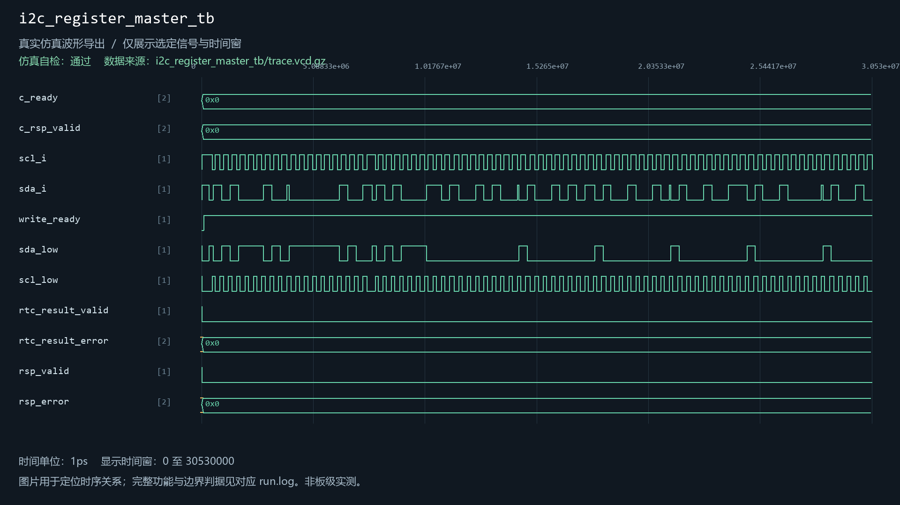
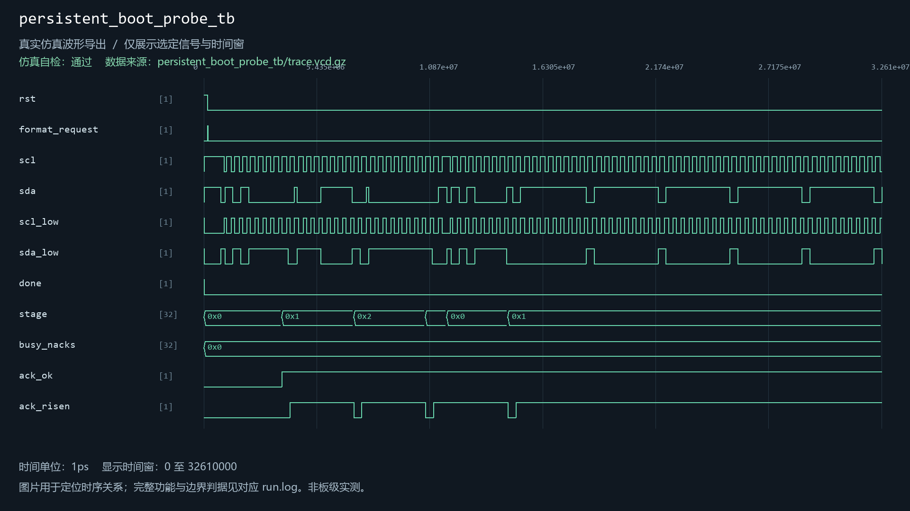
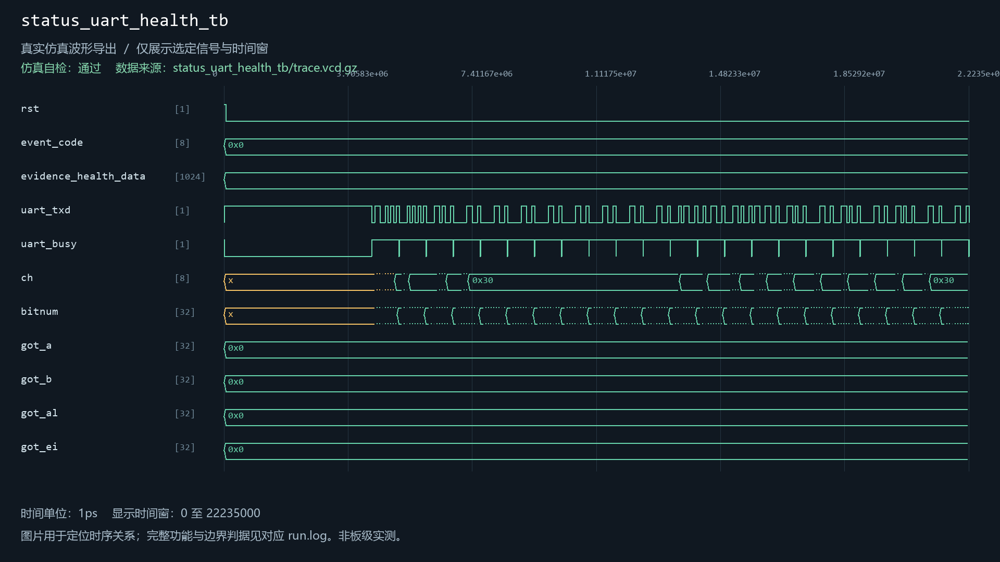
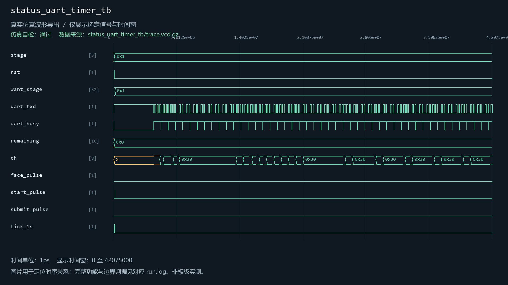
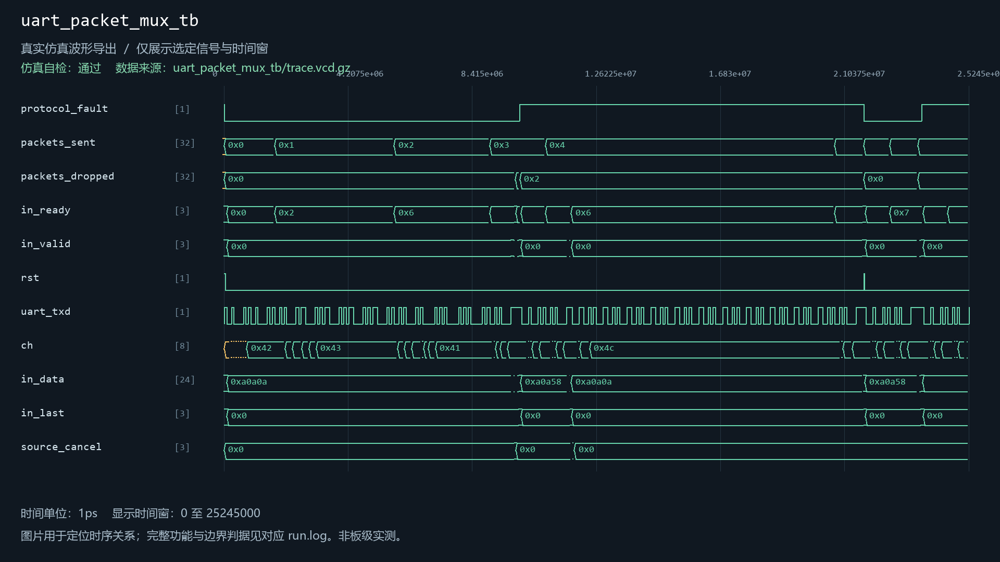
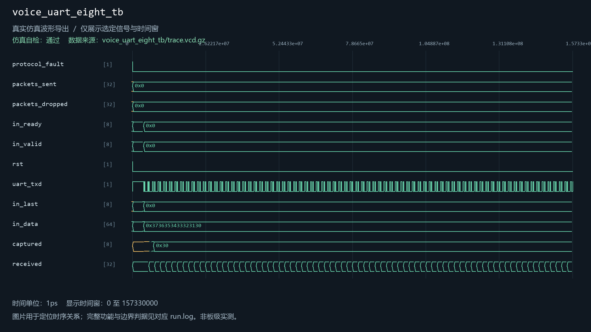

# uart_tx

当前工程实例化：是。关联12个自检用例。

| 用例 | 仿真器 | 当前结果 | 运行日志 | 结果记录 |
| --- | --- | --- | --- | --- |
| camera_evidence_transport_tb | icarus | 通过 | [日志](../../sim/results/quality_current/camera_evidence_transport_tb/run.log) | [记录](../../sim/results/quality_current/camera_evidence_transport_tb/result.json) |
| config_ack_tx_tb | icarus | 通过 | [日志](../../sim/results/quality_current/config_ack_tx_tb/run.log) | [记录](../../sim/results/quality_current/config_ack_tx_tb/result.json) |
| ddr_evidence_probe_tb | icarus | 通过 | [日志](../../sim/results/quality_current/ddr_evidence_probe_tb/run.log) | [记录](../../sim/results/quality_current/ddr_evidence_probe_tb/result.json) |
| evidence_dump_tb | icarus | 通过 | [日志](../../sim/results/quality_current/evidence_dump_tb/run.log) | [记录](../../sim/results/quality_current/evidence_dump_tb/result.json) |
| history_health_stats_tb | icarus | 通过 | [日志](../../sim/results/quality_current/history_health_stats_tb/run.log) | [记录](../../sim/results/quality_current/history_health_stats_tb/result.json) |
| i2c_register_master_tb | icarus | 通过 | [日志](../../sim/results/quality_current/i2c_register_master_tb/run.log) | [记录](../../sim/results/quality_current/i2c_register_master_tb/result.json) |
| persistent_boot_probe_tb | xsim | 通过 | [日志](../../sim/results/quality_current/persistent_boot_probe_tb/run.log) | [记录](../../sim/results/quality_current/persistent_boot_probe_tb/result.json) |
| status_uart_health_tb | xsim | 通过 | [日志](../../sim/results/quality_current/status_uart_health_tb/run.log) | [记录](../../sim/results/quality_current/status_uart_health_tb/result.json) |
| status_uart_timer_tb | icarus | 通过 | [日志](../../sim/results/quality_current/status_uart_timer_tb/run.log) | [记录](../../sim/results/quality_current/status_uart_timer_tb/result.json) |
| transaction_uart_integration_tb | xsim | 通过 | [日志](../../sim/results/quality_current/transaction_uart_integration_tb/run.log) | [记录](../../sim/results/quality_current/transaction_uart_integration_tb/result.json) |
| uart_packet_mux_tb | icarus | 通过 | [日志](../../sim/results/quality_current/uart_packet_mux_tb/run.log) | [记录](../../sim/results/quality_current/uart_packet_mux_tb/result.json) |
| voice_uart_eight_tb | icarus | 通过 | [日志](../../sim/results/quality_current/voice_uart_eight_tb/run.log) | [记录](../../sim/results/quality_current/voice_uart_eight_tb/result.json) |

单独重跑本模块关联用例（工程根目录）：

```powershell
python sim/run_module_tests.py --only camera_evidence_transport_tb config_ack_tx_tb ddr_evidence_probe_tb evidence_dump_tb history_health_stats_tb i2c_register_master_tb persistent_boot_probe_tb status_uart_health_tb status_uart_timer_tb transaction_uart_integration_tb uart_packet_mux_tb voice_uart_eight_tb --vivado-bin "$env:EXAMGUARD_VIVADO_BIN" --iverilog-bin "$env:EXAMGUARD_IVERILOG_BIN"
```

先按[复原说明](../../build/reproduction.md)配置工具。每次生成新的结果目录。

## camera_evidence_transport_tb

用例源码：[camera_evidence_transport_tb.sv](../../sim/sources/ddr3_test/camera_evidence_transport_tb.sv), [axi_frame_slave_model.sv](../../sim/sources/ddr3_test/axi_frame_slave_model.sv)

VCD仿真波形（来源批次见索引）：


## config_ack_tx_tb

用例源码：[config_ack_tx_tb.v](../../src/fpga/ov5640_ddr3_hdmi_vga.srcs/sources_1/host_link/config_ack_tx_tb.v)

VCD仿真波形（来源批次见索引）：



## ddr_evidence_probe_tb

用例源码：[ddr_evidence_probe_tb.sv](../../sim/sources/ddr3_test/ddr_evidence_probe_tb.sv), [axi_frame_slave_model.sv](../../sim/sources/ddr3_test/axi_frame_slave_model.sv), [ddr_evidence_probe.v](../../sim/sources/ddr3_test/ddr_evidence_probe.v)

VCD仿真波形（来源批次见索引）：



## evidence_dump_tb

用例源码：[evidence_dump_tb.v](../../src/fpga/ov5640_ddr3_hdmi_vga.srcs/sources_1/evidence_dump/evidence_dump_tb.v)

VCD仿真波形（来源批次见索引）：



## history_health_stats_tb

用例源码：[history_health_stats_tb.sv](../../sim/sources/health/history_health_stats_tb.sv)

VCD仿真波形（来源批次见索引）：



## i2c_register_master_tb

用例源码：[i2c_register_master_tb.sv](../../sim/sources/persistence/i2c_register_master_tb.sv), [persistence_inventory_probe.sv](../../sim/sources/persistence/persistence_inventory_probe.sv)

VCD仿真波形（来源批次见索引）：



## persistent_boot_probe_tb

用例源码：[persistent_boot_probe_tb.sv](../../sim/sources/persistence/persistent_boot_probe_tb.sv), [persistence_inventory_probe.sv](../../sim/sources/persistence/persistence_inventory_probe.sv), [persistent_boot_probe.sv](../../sim/sources/persistence/persistent_boot_probe.sv)

VCD仿真波形（来源批次见索引）：



## status_uart_health_tb

用例源码：[status_uart_health_tb.sv](../../sim/sources/health/status_uart_health_tb.sv)

VCD仿真波形（来源批次见索引）：



## status_uart_timer_tb

用例源码：[status_uart_timer_tb.sv](../../sim/sources/event_identity/status_uart_timer_tb.sv)

VCD仿真波形（来源批次见索引）：



## transaction_uart_integration_tb

用例源码：[transaction_uart_integration_tb.sv](../../sim/sources/host_link/transaction_uart_integration_tb.sv)

本用例提供上方日志和机器可读结果；尚无截图，不用其他模块图片替代。

## uart_packet_mux_tb

用例源码：[uart_packet_mux_tb.sv](../../sim/sources/host_link/uart_packet_mux_tb.sv)

VCD仿真波形（来源批次见索引）：



## voice_uart_eight_tb

用例源码：[voice_uart_eight_tb.sv](../../sim/sources/voice_interaction/voice_uart_eight_tb.sv)

VCD仿真波形（来源批次见索引）：


