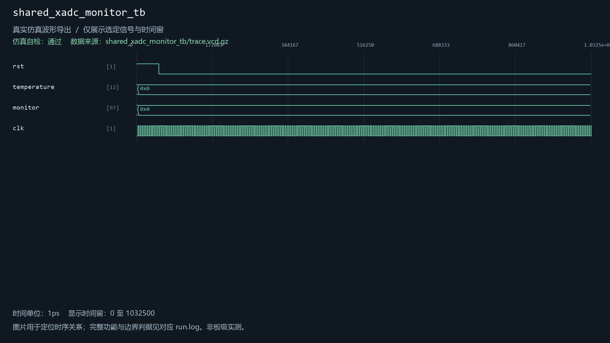
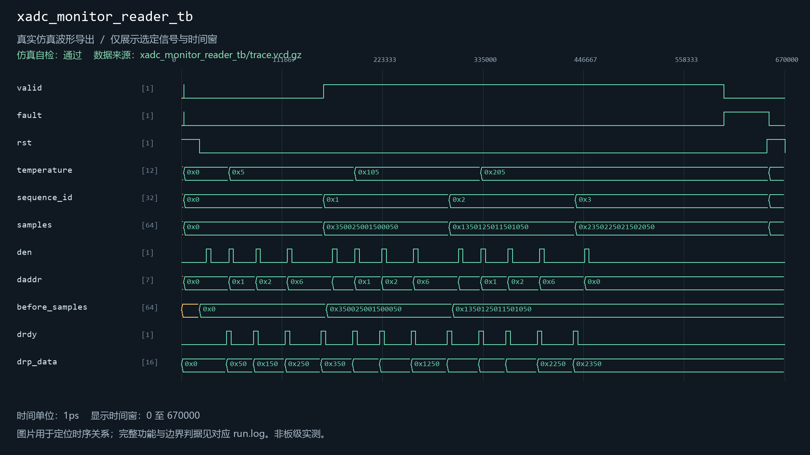

# xadc_monitor_reader

当前工程实例化：是。关联2个自检用例。

| 用例 | 仿真器 | 当前结果 | 运行日志 | 结果记录 |
| --- | --- | --- | --- | --- |
| shared_xadc_monitor_tb | xsim | 通过 | [日志](../../sim/results/quality_current/shared_xadc_monitor_tb/run.log) | [记录](../../sim/results/quality_current/shared_xadc_monitor_tb/result.json) |
| xadc_monitor_reader_tb | icarus | 通过 | [日志](../../sim/results/quality_current/xadc_monitor_reader_tb/run.log) | [记录](../../sim/results/quality_current/xadc_monitor_reader_tb/result.json) |

单独重跑本模块关联用例（工程根目录）：

```powershell
python sim/run_module_tests.py --only shared_xadc_monitor_tb xadc_monitor_reader_tb --vivado-bin "$env:EXAMGUARD_VIVADO_BIN" --iverilog-bin "$env:EXAMGUARD_IVERILOG_BIN"
```

先按[复原说明](../../build/reproduction.md)配置工具。每次生成新的结果目录。

## shared_xadc_monitor_tb

用例源码：[shared_xadc_monitor_tb.sv](../../sim/test_repairs/shared_xadc_monitor_tb/shared_xadc_monitor_tb.sv)

历史VCD数据导出图（并非Vivado截图）：



## xadc_monitor_reader_tb

用例源码：[xadc_monitor_reader_tb.sv](../../sim/sources/health/xadc_monitor_reader_tb.sv)

历史VCD数据导出图（并非Vivado截图）：


